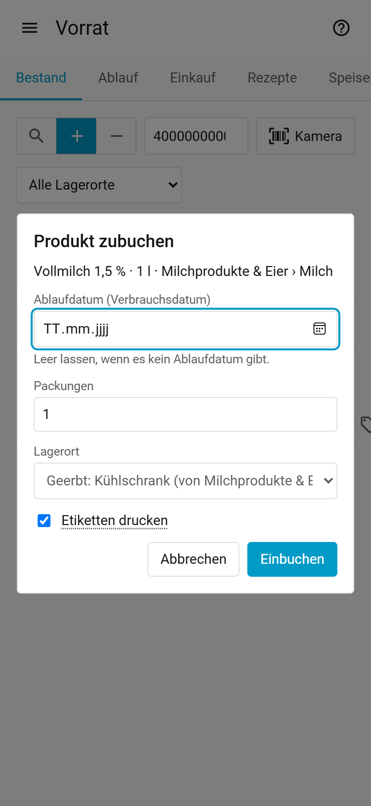
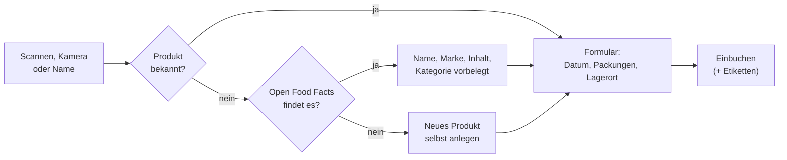
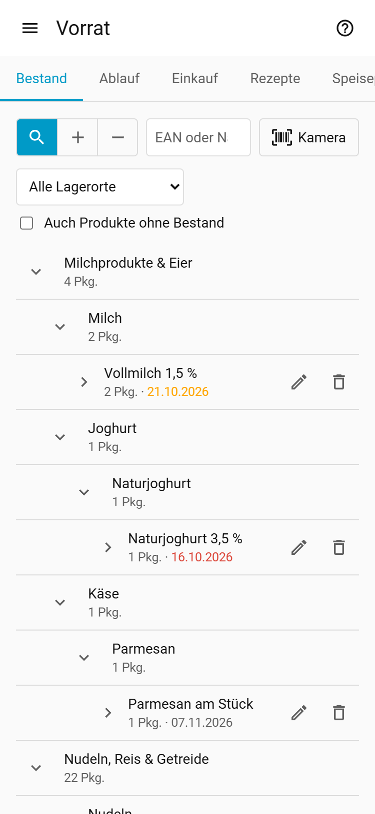
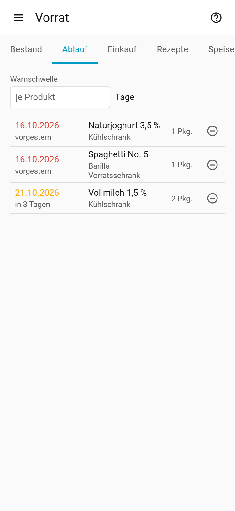
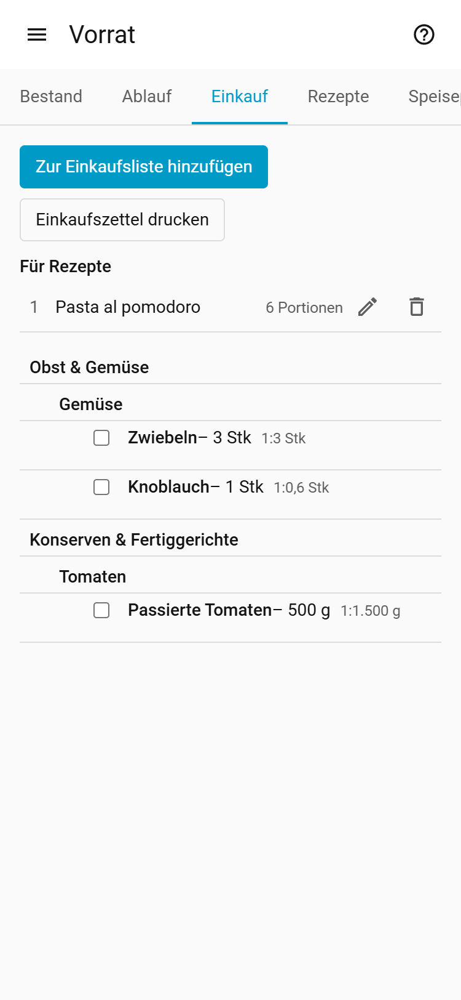
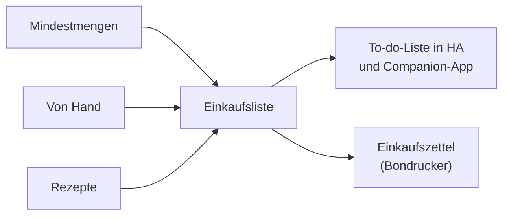
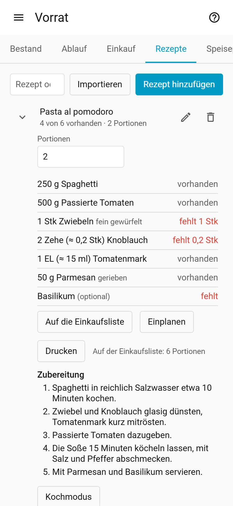
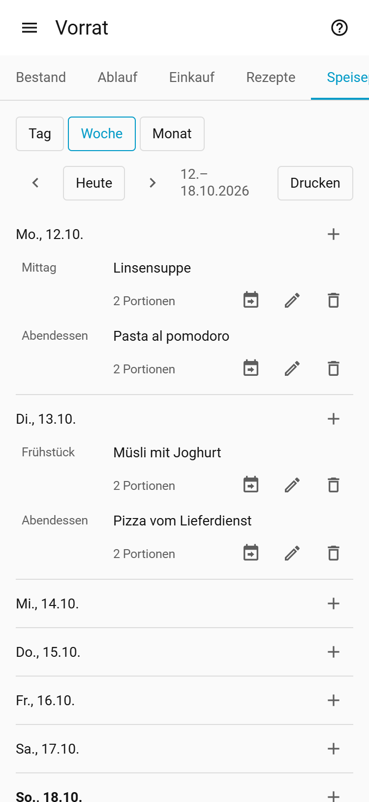
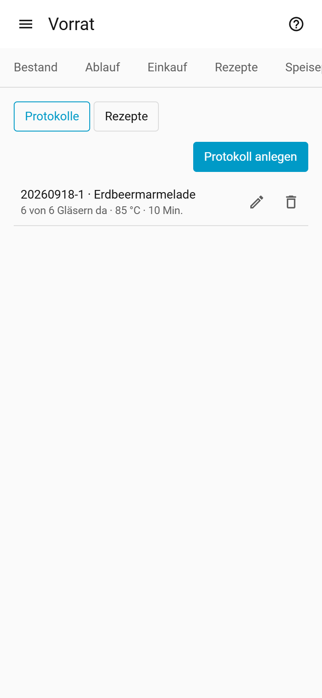
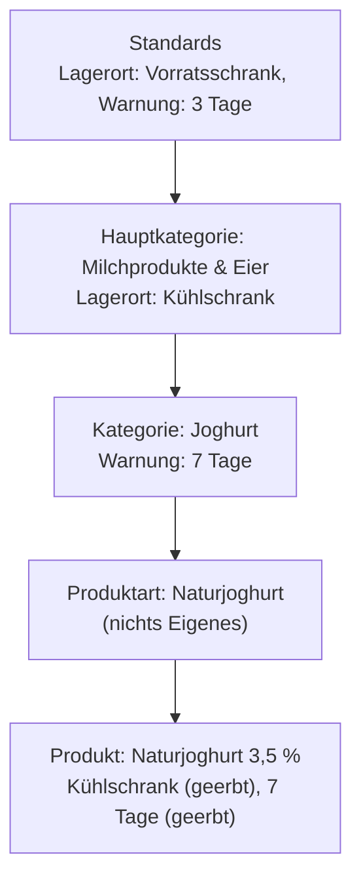

# Vorrat – Anleitung

*English version: [guide.en.md](guide.en.md)*

Vorrat ist die Vorratsverwaltung in Home Assistant. Du buchst Vorräte per Barcode oder Namen ein
und aus: Lebensmittel, Batterien, Haushaltswaren, Medikamente und selbst eingekochte Gläser. Vorrat merkt sich, wo was liegt und wann es abläuft, erinnert an Ablaufendes und führt
die Einkaufsliste aus Mindestmengen, Rezepten und eigenen Einträgen. Diese Anleitung erklärt die Bedienung; Installation und
Technik stehen im [README](../README.de.md).

Du findest Vorrat in der Seitenleiste von Home Assistant. Das Fragezeichen oben rechts öffnet diese
Anleitung. Oben gibt es diese Tabs:

| Tab | Wofür |
|---|---|
| **Bestand** | Einbuchen, auslagern, suchen; was ist wo da? ([2](#2-einkäufe-einbuchen)–[4](#4-bestand-ansehen-und-korrigieren)) |
| **Ablauf** | Abgelaufenes und bald Fälliges ([5](#5-was-läuft-ab)) |
| **Einkauf** | Einkaufsliste aus Mindestmengen, Rezepten und von Hand ([6](#6-einkaufsliste)) |
| **Rezepte** | Rezepte mit Vorratsabgleich, Import und Kochmodus ([7](#7-rezepte)) |
| **Speiseplan** | Gerichte nach Tag und Mahlzeit ([7a](#7a-speiseplan)) |
| **Einkochen** | Einkochprotokolle und Einkochrezepte ([7b](#7b-einkochen)) |
| **Einstellungen** | Nur Admins: Lagerorte, Einheiten, Kategorien, Standards ([1](#1-erste-schritte), [9](#9-kategorien-produktarten-und-vererbung)) |

## Inhalt

1. [Erste Schritte](#1-erste-schritte)
2. [Einkäufe einbuchen](#2-einkäufe-einbuchen)
3. [Verbrauchen und auslagern](#3-verbrauchen-und-auslagern)
3a. [Packung anbrechen](#3a-packung-anbrechen)
4. [Bestand ansehen und korrigieren](#4-bestand-ansehen-und-korrigieren)
5. [Was läuft ab?](#5-was-läuft-ab)
6. [Einkaufsliste](#6-einkaufsliste)
7. [Rezepte](#7-rezepte)
7a. [Speiseplan](#7a-speiseplan)
7b. [Einkochen](#7b-einkochen)
8. [Etiketten und Bondrucker](#8-etiketten-und-bondrucker)
9. [Kategorien, Produktarten und Vererbung](#9-kategorien-produktarten-und-vererbung)
10. [Tipps und häufige Fragen](#10-tipps-und-häufige-fragen)

## 1. Erste Schritte

Vorrat bringt eine fertige Grundausstattung mit: Lagerorte (Kühlschrank, Gefrierschrank,
Vorratsschrank …), Einheiten (g, kg, ml, l, Stück, Packung, EL, TL …) und einen Kategoriebaum mit
rund 1.700 Produktarten (Tomatenmark, Spaghetti, Basmatireis …). Dazu kommen Kategorien für
Nicht-Lebensmittel (Haushalt & Drogerie, Haustechnik, Hausapotheke, Tierbedarf) und
Eingekochtes. Du kannst direkt loslegen.

Für Admins lohnt sich vorher ein Blick in **Einstellungen**:

1. **Lagerorte**: Passe die Liste an deinen Haushalt an (umbenennen, hinzufügen, löschen).
   Der Pfeil-Knopf **„<Ort>“ umlagern** verschiebt den ganzen Bestand eines Lagerorts in einen anderen
   (z. B. beim Umzug des Gefrierschranks); der Lagerort bleibt bestehen. Der Dialog zeigt vorher, wie
   viele Chargen und Packungen umziehen. Gleiche Chargen am Ziel werden zusammengelegt.
2. **Standards**: Lege fest, was gilt, wenn eine Kategorie oder ein Produkt nichts Eigenes hat
   (Einheit, Lagerort, Datumsart, Warnung vor Ablauf, Haltbarkeit).
3. **Einheiten**: Mit dem Häkchen **Nur für Rezepte** blendest du eine Einheit (z. B. EL) bei Produkten, Mindestmengen und Standards aus. Für Rezeptzutaten bleibt sie wählbar.
4. **Kategorien**: Gib Kategorien einen Standard-Lagerort (z. B. Milchprodukte & Eier → Kühlschrank).
   Dann musst du beim Einbuchen seltener einen Lagerort wählen.
5. Optional: Brauchst du nicht alles? Unter *Einstellungen → Geräte & Dienste → Home Inventory → Konfigurieren → Module* schaltest du Einkaufsliste, Rezepte, Speiseplan und Einkochen einzeln ab (auch schon beim Einrichten wählbar). Der Tab verschwindet, die Daten bleiben erhalten.
6. Optional: Richte einen Etikettendrucker oder Bondrucker ein (siehe [Etiketten und Bondrucker](#8-etiketten-und-bondrucker)).

## 2. Einkäufe einbuchen

<picture><source media="(prefers-color-scheme: dark)" srcset="images/book-in-dark.png"></picture>

Öffne **Bestand** und stelle den Schalter vor dem Eingabefeld auf **+** (Einbuchen). Die drei
Knöpfe sind **Lupe** (Suchen), **+** (Einbuchen) und **−** (Auslagern); der gewählte ist gefüllt.
Das Eingabefeld ist sofort bereit. Der Schalter bleibt so, bis du ihn umstellst oder den Tab wechselst.

> [!TIP]
> Ein Lesezeichen auf `/pantry/in` öffnet den Bestand gleich mit **Einbuchen**, `/pantry/out` mit
> **Auslagern**. Praktisch fürs Küchentablet.

1. **Produkt finden**, auf eine von drei Arten:
   - Mit einem USB- oder Bluetooth-Barcodescanner scannen. Der Scanner tippt den Barcode ins Feld.
   - **Kamera** antippen und den Barcode vor die Handykamera halten.
   - Einen Namen tippen und <kbd>Enter</kbd> drücken.

   Es öffnet sich ein Fenster: bei einem Namen erst die Treffer zur Auswahl, dann das Formular.
   **Abbrechen**, <kbd>Esc</kbd> oder ein Tipp daneben schließen es. Hast du schon etwas eingegeben, fragt
   Vorrat vorher nach.
2. **Bekanntes Produkt**: Es erscheinen nur die Felder für diese Buchung.
   **Unbekannter Barcode**: Vorrat fragt Open Food Facts und füllt Name, Marke, Inhalt und eine
   passende Kategorie vor. Ist eine KI eingerichtet, prüft sie diese Angaben gleich danach („KI prüft
   das neue Produkt …“) und korrigiert Name, Kategorie und Inhalt; oben steht dann „Von der KI
   geändert: … (vorher: …)“ mit **Rückgängig**. Fehlt eine passende Produktart, schlägt die KI eine
   neue vor („Neue Produktart … wird beim Einbuchen angelegt“). Prüfe die Angaben. Findet sich nichts, legst du das Produkt mit
   **Neues Produkt** selbst an; über **Online suchen** suchst du bei Open Food Facts nach Namen.
3. **Kategorie**: Jedes neue Produkt braucht eine Kategorie, am besten eine Produktart
   (z. B. „Tomatenmark“). Tippe in das Filterfeld der Kategorieauswahl. Fehlt die passende,
   wähle **„…“ neu anlegen** und danach die übergeordnete Kategorie.
4. **Inhalt** (optional): z. B. 500 g pro Packung, bei Konserven das Abtropfgewicht. Damit rechnen
   Mindestmengen und Rezepte.
5. **Mindestanzahl** (optional): Unter dieser Packungszahl kommt das Produkt auf die Einkaufsliste.
6. **Ablaufdatum**: Das Datum von der Packung. Leer lassen, wenn es keins gibt.
   Die Beschriftung nennt die Datumsart (Mindesthaltbarkeit oder Verbrauchsdatum). Hat die Kategorie
   oder das Produkt eine *Haltbarkeit*, schlägt Vorrat heute + Haltbarkeit vor (siehe
   [Kategorien](#9-kategorien-produktarten-und-vererbung)).
7. **Packungen** und **Lagerort**: Der Lagerort ist vorbelegt (grau: „Geerbt: Kühlschrank (von
   Milchprodukte & Eier)“). Eine andere Wahl gilt nur für diese Buchung; **Zurücksetzen** kehrt zum Standard
   zurück. Bei neuen Produkten merkt sich **Wird Standardlager** den gewählten Ort fürs Produkt.
8. **Etiketten drucken** (falls eingerichtet) und **Einbuchen**.

> [!NOTE]
> Dasselbe Produkt mit demselben Datum landet in derselben Charge. Ein anderes Datum ergibt eine neue
> Charge, so siehst du später, welche Packung zuerst weg muss.

## 3. Verbrauchen und auslagern

Stell den Schalter im **Bestand** auf **−** (Auslagern; als Lesezeichen: `/pantry/out`). Dann geht es wie beim Einbuchen: scannen, Kamera oder Name, danach das Fenster.

- Standardmäßig wird die Packung mit dem frühesten Datum genommen. Du kannst auch eine bestimmte
  Charge und einen Lagerort wählen.
- **Etikett scannen**: Ein Vorrat-Etikett (QR-Code) bucht genau eine Packung dieser Charge aus,
  egal ob der Schalter auf Einbuchen oder Auslagern steht (auf Anbrechen bricht er sie an, siehe 3a).
- **Rückgängig** neben der Meldung legt die Packungen zurück, wohin sie gehörten. Das geht einmal pro
  Buchung.
- Im **Bestand** und unter **Ablauf** nimmt das Minus an einer Charge eine Packung aus genau dieser
  Charge.

> [!NOTE]
> Kochen nach Rezept bucht nichts automatisch aus. Lagere die Zutaten wie gewohnt aus.

## 3a. Packung anbrechen

Milch, Marmelade oder Pesto halten offen nicht mehr bis zum aufgedruckten Datum. Markiere die Packung
beim Öffnen als angebrochen, dann rechnet Vorrat mit dem kürzeren Datum.

- **Im Bestand**: an der Charge das Symbol mit der offenen Schachtel (**Anbrechen**) antippen. Es bricht
  genau eine Packung dieser Charge an diesem Lagerort an.
- **Per Scan**: den Schalter auf die offene Schachtel stellen (Anbrechen; als Lesezeichen:
  `/pantry/open`). Ein gescanntes Vorrat-Etikett bricht eine Packung dieser Charge an; Barcode oder
  Name brechen die Packung mit dem frühesten Datum an.
- **Per Automation**: Aktion `pantry.open_package` (siehe [README](../README.de.md#aktionen-automationen)).

Die angebrochene Packung bekommt eine eigene Zeile „… · angebrochen am …“ und läuft nach der
*Haltbar nach Anbruch* der Kategorie oder des Produkts ab (z. B. Milch 3 Tage), nie später als das
aufgedruckte Datum. Ist dort nichts eingetragen (Nudeln), bleibt das Datum. Sie zählt weiter zum
Bestand und zur Mindestmenge; **Ablauf**, die Sensoren und die Rezeptvorschläge nutzen das neue Datum.
Beim Auslagern und beim Etikett-Scan wird die angebrochene Packung zuerst genommen.

Nach dem Anbrechen stehen neben der Meldung:

- **Rückgängig**: macht die Packung wieder ungeöffnet (einmal, solange sie noch im Bestand ist).
- **Etikett drucken**: öffnet den Etikettendialog mit dem neuen Datum. Gedruckt wird erst mit
  **Drucken** dort, nie automatisch.

## 4. Bestand ansehen und korrigieren

<picture><source media="(prefers-color-scheme: dark)" srcset="images/stock-dark.png"></picture>

**Bestand** zeigt den Kategoriebaum mit allem, was da ist, mit Anzahl und frühestem Datum.

- Eine Zeile antippen klappt sie auf. Ein Produkt zeigt seine Chargen (Datum, Lagerort, Packungen).
- Das Eingabefeld filtert die Liste beim Tippen nach Name, Marke, Barcode, Kategorie und Lagerort.
  Steht der Schalter auf der **Lupe** (Suchen), öffnet <kbd>Enter</kbd> kein Fenster. So findest du ein Produkt auch mit dem
  Scanner, um es zu bearbeiten, ohne etwas zu buchen.
- **Alle Lagerorte** filtert nach einem Lagerort. **Auch Produkte ohne Bestand** zeigt leere Produkte,
  um sie zu bearbeiten oder zu löschen.
- **Stift am Produkt**: Name, Marke, Barcode, Kategorie, Inhalt, Mindestanzahl und eigene Vorgaben
  (Lagerort, Datumsart, Warnung vor Ablauf).
- **Stift an einer Charge**: Datum oder Packungszahl korrigieren, etwa nach einem Tippfehler.
  0 Packungen entfernt die Charge.
- **Etikett-Symbol**: Etiketten für diese Charge nachdrucken.
- Eingekochte Gläser zeigen ihre Charge neben dem Datum.
- Rot heißt abgelaufen, orange heißt bald fällig.

## 5. Was läuft ab?

<picture><source media="(prefers-color-scheme: dark)" srcset="images/expiry-dark.png"></picture>

**Ablauf** listet alle abgelaufenen (rot) und bald ablaufenden (orange) Chargen, das früheste Datum
zuerst. „Bald“ heißt: innerhalb der *Warnung vor Ablauf* des Produkts (geerbt oder eigen).
**Warnschwelle** setzt vorübergehend eine Zahl für alle, z. B. 14 Tage zur Essensplanung; gespeichert
wird nichts.

Darunter schlägt **Rezepte für Ablaufendes** Rezepte vor, die Ablaufendes oder Abgelaufenes aufbrauchen
(Lebensmittel, gleiche Schwelle wie die Liste, auch die vorübergehende). Die meisten verbrauchten Zutaten
stehen oben, bei gleicher Zahl das Rezept mit mehr vorhandenen Zutaten. Ein Tipp öffnet das Rezept. Im Tab
**Rezepte** trägt so ein Rezept die Markierung „Ablaufendes: n“; *Nur mit Ablaufendem* filtert darauf.

> [!TIP]
> Für Automationen gibt es die Sensoren *Abgelaufen* und *Läuft bald ab* (siehe [README](../README.de.md#sensoren)), z. B. für
> eine Benachrichtigung aufs Handy.

## 6. Einkaufsliste

<picture><source media="(prefers-color-scheme: dark)" srcset="images/shopping-dark.png"></picture>

Die Einkaufsliste im Tab **Einkauf** speist sich aus drei Quellen:

- **Mindestmengen**: In den Kategorien (Einstellungen) legst du eine *Mindestmenge* (z. B. 2 kg
  Nudeln, egal welche Marke) und/oder eine *Mindestanzahl* (Packungen) fest. Am Produkt gibt es eine
  eigene *Mindestanzahl* für Lieblingsprodukte. Fehlt etwas, erscheint es auf der Liste: „Nudeln –
  500 g fehlen“ oder „Barilla · 2 Pkg. fehlen“. Mindestmengen zählen die ganze Kategorie samt
  Unterkategorien, und nichts wird doppelt gezählt.
- **Von Hand**: **Zur Einkaufsliste hinzufügen**, Namen tippen, Produkt oder Kategorie wählen,
  Anzahl angeben. Ein neues Produkt wird dabei gleich angelegt.
- **Aus Rezepten**: Im Rezept tippst du **Auf die Einkaufsliste**, wählst die Portionen und die
  optionalen Zutaten, die du brauchst. Die fehlenden Mengen aller Rezepte werden pro Kategorie
  zusammengezählt. Die Rezepte sind nummeriert (1, 2, 3 …); hinter jedem Eintrag steht klein, welches Rezept wie viel braucht („1:300 g; 2:200 g“). Ein Rezept bleibt auf
  der Liste, bis du es entfernst: Das machst du im Tab **Einkauf** unter **Für Rezepte** mit dem
  Papierkorb, z. B. nach dem Kochen. Portionen und optionale Zutaten änderst du dort mit dem Stift.

  Mengen in Rezept-Einheiten wie EL, Tasse oder Prise werden so umgerechnet:

  | Fall | Ergebnis | Beispiel |
  |---|---|---|
  | Einheit passt zur Kategorie | ml bei Volumen, g bei Gewicht | 3 EL Öl → 45 ml |
  | passt nicht, nichts davon im Vorrat | Grundeinheit der Einheit | 2 EL Kapern → 30 ml |
  | Scheibe | bleibt wie geschrieben | 2 Scheiben |
  | ohne Menge | 1 Packung | Salz → 1 Pkg. |

Abhaken streicht einen Eintrag durch. Bei einem Mindestmengen-Eintrag verschwindet der Haken von selbst,
wenn sich die fehlende Menge ändert, z. B. wenn du nur einen Teil eingekauft hast.

Dieselbe Liste gibt es als To-do-Liste **Einkaufsliste** in Home Assistant und in der Companion-App.
Dort kannst du abhaken und Einträge mit dem genauen Namen eines Produkts oder einer Kategorie
hinzufügen (die Entität heißt `todo.vorrat_einkaufsliste`). **Erledigte entfernen** löscht dort nur
abgehakte Einträge, die von Hand hinzugefügt wurden; Mindestmengen-Einträge bleiben, bis der Bestand da ist.

**Einkaufszettel drucken**: Mit einem Bondrucker druckt dieser Knopf alle noch nicht abgehakten
Einträge, nach Hauptkategorien sortiert, und schneidet das Papier ab. Der Knopf erscheint nur, wenn
ein Bondrucker eingerichtet ist (siehe [Etiketten und Bondrucker](#8-etiketten-und-bondrucker)).

## 7. Rezepte

<picture><source media="(prefers-color-scheme: dark)" srcset="images/recipe-dark.png"></picture>

**Rezepte** zeigt alle Rezepte mit dem Stand „5 von 7 vorhanden“ (Einkochrezepte stehen im Tab
[Einkochen](#7b-einkochen), nicht hier). Das Suchfeld findet Name und
Zutaten. Eine Zeile aufklappen zeigt Zutaten mit Status, die nummerierten Schritte, Quelle und Bild; **Portionen**
rechnet die Mengen um (nur Anzeige). **Auf die Einkaufsliste** setzt das Rezept auf die Liste
(siehe [Einkaufsliste](#6-einkaufsliste)). **Einplanen** trägt es mit den angezeigten Portionen in den
[Speiseplan](#7a-speiseplan) ein (Datum: heute, Mahlzeit: Abendessen; im Dialog änderbar).

**Rezept hinzufügen**:

1. Name und Portionen eintragen.
2. Pro Zutat: im Feld **Zutat** eine Produktart oder Kategorie suchen (auch über einen Produktnamen,
   „Mutti“ findet Tomatenmark). Fehlt sie, **Neue Produktart „…“ anlegen**.
3. Menge und Einheit (beide oder keins), optional ein **Hinweis** wie „fein gewürfelt“.
4. **optional** für Zutaten, die das Rezept nicht unbedingt braucht. **Nicht gegen den Vorrat prüfen** für
   Dinge, die du nicht im Vorrat führst (Salz, Wasser).
5. Fehlt eine Einheit, wähle **Neue Einheit …** in der Einheitenauswahl.
6. Unter **Zubereitung** mit **Schritt hinzufügen** die Schritte eintragen, einen pro Feld. Die
   Pfeile verschieben einen Schritt, das Kreuz entfernt ihn. **Zwischenüberschrift hinzufügen**
   teilt das Rezept in Abschnitte (z. B. „Teig“, „Füllung“); die Nummern laufen weiter.

> [!NOTE]
> Ältere Rezepte haben noch einen einzigen Anleitungstext. Beim nächsten Bearbeiten steht er an
> Leerzeilen in Schritte geteilt im Dialog; mit dem Speichern wird daraus die Schrittliste.

**Drucken**: Mit einem Bondrucker druckt dieser Knopf im aufgeklappten Rezept Name, Portionen,
die Zutaten zum Abhaken (Mengen für die angezeigten Portionen) und die nummerierten Schritte. Der
Knopf erscheint nur, wenn ein Bondrucker eingerichtet ist.

**Kochmodus**: Im aufgeklappten Rezept öffnet **Kochmodus** Zutaten (für die angezeigten Portionen)
und Schritte im Vollbild. Ein Tipp auf einen Schritt hakt ihn ab (wird nicht gespeichert). Steht in
einem Schritt eine Zeit („20 Minuten“, „ca. 10–15 Min.“, „eine halbe Stunde“), gibt es dazu einen
Timer-Knopf; bei einer Spanne gilt der höhere Wert. Mehrere Timer laufen gleichzeitig und stehen
unten; ein abgelaufener piept, vibriert und wird rot. Der Bildschirm bleibt an, solange der
Kochmodus offen ist (wenn der Browser es erlaubt).

> [!WARNING]
> Die Timer laufen nur in diesem Browserfenster. Schließen fragt nach und beendet sie.

Einheiten mit Häkchen *Nur für Rezepte* (z. B. EL, TL, Tasse, Prise) stehen nur hier zur Wahl. Hat
die Einheit eine Umrechnung, zeigt das Rezept die Menge dazu: „3 EL (≈ 45 ml)“. Die Größen sind
Faustregeln:

| Einheit | Größe |
|---|---|
| Tasse | 250 ml |
| Prise, Messerspitze | 0,5 g |
| Zehe | 0,1 Stück (Einkaufsliste rundet auf: 3 Zehen → 1 Knoblauch) |
| Handvoll | 30 g |
| Tropfen | 0,05 ml |
| Spritzer | 1 ml |
| Schuss | 20 ml |
| Zweig, Stiel | 0,1 Bund |
| Scheibe | keine Größe, bleibt auf der Einkaufsliste wie geschrieben („2 Scheiben“) |

Eine Einheit, die ein Rezeptimport anlegt, ist zunächst nur für Rezepte.

**Importieren**: Füge die Adresse eines Rezepts ein (z. B. Chefkoch, Mealie, Tandoor). Vorrat liest
die Rezeptdaten der Seite und öffnet den Rezeptdialog vorausgefüllt, mit den Schritten der Seite
(steht dort nur ein Textblock, wird er an Zeilenumbrüchen oder seiner eigenen Nummerierung geteilt). Gespeichert wird erst, wenn du
speicherst. Jede Zutat zeigt ihre Originalzeile; prüfe die vorgeschlagenen Produktarten. Eine
unbekannte Einheit (z. B. „Tasse“) legst du mit **Anlegen** an oder wählst eine vorhandene.

**Rezept aus Instagram, TikTok, YouTube, Text oder Foto** (wenn eine KI eingerichtet ist): Oben im
Importdialog wählst du die Quelle.

- **Link**: Hat die Seite keine Rezeptdaten (Instagram-Reel, TikTok, YouTube-Short, Blog), liest die
  KI den Beitrag aus: Beschreibung, Video (auch Gesprochenes und eingeblendeten Text) oder Bild. Den
  Link holst du in der App über *Teilen > Link kopieren*.
- **Text**: Rezepttext einfügen, z. B. aus einer Nachricht; die KI ordnet ihn in Zutaten und Schritte.
- **Foto**: ein Foto einer Kochbuchseite oder ein Screenshot.

**Importieren** zeigt „Rezept wird gelesen …“; mit KI dauert das bis zu einer Minute. Danach öffnet
sich der Rezeptdialog wie bei jedem Import (mit KI-Prüfung). Findet die KI kein Rezept oder schlägt
sie fehl, bleibt der Importdialog mit deiner Eingabe offen. Instagram gibt Videos ohne Anmeldung oft
nicht heraus; dann liest die KI nur Beschreibung und Bild. Steht das Rezept nur im Video, nimm den
Link von TikTok oder YouTube, falls es den Beitrag dort auch gibt.

**KI-Prüfung** (wenn eingerichtet, siehe unten): Direkt nach dem Öffnen prüft die KI den Import.
Oben steht „KI prüft das Rezept …“; Speichern wartet so lange, **Nicht abwarten** überspringt die
Prüfung. Danach steht dort „keine Änderungen“ oder was die KI geändert hat: Zutaten mit besserer
Kategorie oder Einheit sind markiert („Von der KI geändert: … (vorher: …)“, mit **Rückgängig**);
eine neue Einheit, die die KI vorschlägt, legst du mit **Anlegen** an. Ein langer
Textblock ist in Schritte geteilt (**Schritte zurücksetzen** stellt ihn wieder her). Fehlt im
Kategoriebaum eine passende Produktart (z. B. ein seltenes Gewürz), schlägt die KI eine neue
unter der passenden Kategorie vor („KI schlägt neue Produktart … vor“); er wird erst beim
Speichern angelegt, **Rückgängig** verwirft den Vorschlag. Prüfe die
Änderungen vor dem Speichern. Schlägt die KI fehl, bleibt der Entwurf wie importiert.

Vorrat merkt sich, welche Kategorie du für eine importierte Zutat gespeichert hast: Beim nächsten
Import derselben Zutat ist sie gleich gewählt. Ebenso merkt sich Vorrat, wenn du beim Einbuchen die von
Open Food Facts vorgeschlagene Kategorie änderst.

**KI einrichten** (Admin, einmalig):

1. In Home Assistant eine KI mit *KI-Aufgabe* einrichten, z. B. *Einstellungen > Geräte & Dienste >
   Integration hinzufügen > Google Gemini* mit einem API-Schlüssel aus Google AI Studio (es gibt ein
   kostenloses Kontingent).
2. *Einstellungen > Geräte & Dienste > Home Inventory > Konfigurieren > KI (Rezeptimport, Assistenten)*:
   die KI-Aufgabe wählen. Leer = keine KI.

> [!IMPORTANT]
> Jeder Import schickt das Rezept und den Baum der Lebensmittel-Kategorien an die gewählte KI
> (etwa 10.000 Tokens); das Auslesen eines Beitrags schickt auch sein Video oder Bild.

**Mit einem KI-Assistenten** (Assist, Claude Desktop über MCP): Frag z. B. „Was läuft diese Woche
ab?“, „Was kann ich mit dem Vorrat kochen?“ oder „Setz Milch auf die Einkaufsliste“. Einrichten (Admin):

1. Im Assist-Agenten (z. B. *Google Gemini > Konfigurieren*) unter *Home Assistant steuern* die
   LLM-API **Home Inventory** anhaken, oder in der Integration *Model Context Protocol Server*.
2. Unter *Konfigurieren > KI (Rezeptimport, Assistenten) > Zugriff für Assistenten* festlegen, was
   er darf: *Nur lesen*, *Lesen, Einkaufsliste und Speiseplan* (Standard) oder *Alles, auch Ein- und
   Ausbuchen und Anbrechen*.

Produkte, Rezepte und Lagerorte nennst du beim Namen, wie sie im Vorrat heißen.

Status der Zutaten: *vorhanden*, *teilweise*, *fehlt*, *Menge unbekannt* (Produkte ohne Inhaltsangabe),
*keine Zutat zugeordnet*, *nicht geprüft*.

## 7a. Speiseplan

<picture><source media="(prefers-color-scheme: dark)" srcset="images/plan-dark.png"></picture>

**Speiseplan** zeigt den Plan als **Tag**, **Woche** oder **Monat** (Knöpfe oben). **Zurück** und **Weiter** springen um einen Tag, eine Woche oder einen Monat, je nach Ansicht; **Heute** springt zum heutigen Datum. Beim Öffnen des Tabs steht der Plan auf heute; ein Wechsel der Ansicht behält das gewählte Datum.

- **Woche**: Tabelle mit einer Zeile pro Mahlzeit und einer gleich breiten Spalte pro Tag. Auf dem Handy wird jeder Tag zu einem Block, der nur seine Gerichte zeigt, dazu ein **+**. Ein Tipp auf die Tagesüberschrift öffnet die Tagesansicht dieses Tags.
- **Tag**: Liste nach Mahlzeit gruppiert, mit **+** je Mahlzeit.
- **Monat**: Kalender mit einem kleinen Symbol je geplantem Gericht (der Name erscheint beim Darüberfahren oder langen Drücken). Ein Tipp auf einen Tag öffnet seine Tagesansicht.

**Mahlzeit**: Jedes Gericht gehört zu einer Mahlzeit: Frühstück, Mittag, Kaffee, Abendessen oder Snack. Innerhalb eines Tages stehen die Gerichte nach Mahlzeit, dann in der Reihenfolge, in der sie angelegt wurden.

**Gericht hinzufügen** (**+** bei der Mahlzeit):

1. Ein Rezept aus der Namensliste wählen oder freien Text eintippen (z. B. „Pizza vom Lieferdienst“). Ein Rezept wird als Abendessen eingeplant, im Dialog änderbar.
2. **Portionen** startet mit der Haushaltsgröße (siehe unten); ändern, wenn das Gericht für mehr oder weniger Leute ist.
3. Speichern.

Ein Tipp auf den Namen öffnet das Rezept (bei freiem Text den Bearbeiten-Dialog). Der Stift ändert ein Gericht, der Papierkorb löscht es. Wird ein Rezept gelöscht, bleiben seine Gerichte im Plan als freier Text; die Löschfrage listet sie auf.

**Umplanen**: Das Pfeil-Symbol bei einem Gericht verschiebt dessen Mahlzeit an diesem Tag und an jedem direkt folgenden Tag, an dem dieselbe Mahlzeit geplant ist, auf den jeweils nächsten Tag. Die Verschiebung stoppt am ersten Tag ohne diese Mahlzeit (die Lücke). Andere Mahlzeiten bleiben stehen. Eine Bestätigung listet jedes Gericht mit altem und neuem Datum; erst **Verschieben** wendet es an.

**Drucken**: In **Tag** und **Woche** druckt dieser Knopf den Tag bzw. die Woche (Montag bis Sonntag) auf dem Bondrucker, pro Tag mit allen Gerichten. Der Knopf erscheint nur mit Bondrucker; der Monat passt nicht auf einen Bon.

**Einkaufsliste**: Dieser Knopf öffnet einen Dialog mit **Von** und **Bis**, vorbelegt mit heute bis sechs Tage später. **Auf die Liste** setzt jedes in diesem Zeitraum geplante Rezept mit den addierten Portionen all seiner Mahlzeiten auf die Einkaufsliste; was im Vorrat ist, wird abgezogen, wie bei [Rezepten auf der Einkaufsliste](#6-einkaufsliste). Gerichte mit freiem Text werden übersprungen, und ein Rezept, das schon auf der Liste steht, behält die größeren Portionen. **Bis** darf nicht vor **Von** liegen (höchstens 366 Tage). Eine Zeile über dem Plan nennt, was hinzugekommen ist. Eine Verbrauchsprognose gibt es noch nicht.

**Mahlzeiten** (nur Admins): Unter *Einstellungen > Mahlzeiten* legst du fest, ab wann eine Mahlzeit gilt (Standard: Frühstück 05:00, Mittag 11:00, Kaffee 14:30, Abendessen 17:00, Snack 20:30). Danach richtet sich die Aktion *Geplantes Rezept drucken* ohne Angabe der Mahlzeit, z. B. ein Knopf in der Küche, der das Rezept für die nächste Mahlzeit druckt.

**Haushaltsgröße** (nur Admins): unter *Einstellungen > Geräte & Dienste > Home Inventory > Konfigurieren*, Schritt **Haushalt** (Menü *Einstellungen*), **Portionen im Haushalt** setzen (1 bis 99, Standard 3). Das ist der Portionen-Vorschlag für neue Gerichte.

**Kalender**: Der Plan ist zusätzlich ein nur lesbarer Kalender in Home Assistant, Entität *Speiseplan*. Jedes Gericht ist ein ganztägiges Ereignis mit dem Titel „Mahlzeit: Gericht“ (z. B. „Mittag: Spaghetti“); die Beschreibung zeigt die Portionen. Geändert wird der Plan nur in Vorrat.

## 7b. Einkochen

<picture><source media="(prefers-color-scheme: dark)" srcset="images/canning-dark.png"></picture>

Selbst eingekochte Gläser (Marmelade, Kompott, Eingelegtes …) buchst du über ein **Einkochprotokoll**
ein. Jedes Protokoll bekommt eine Charge. Die Etiketten tragen sie, daher bucht ein Scan genau ein
Glas dieser Charge aus.

Der Tab **Einkochen** hat oben zwei Knöpfe: **Protokolle** und **Rezepte**.

**Protokolle** zeigt die Protokolle, neueste zuerst, mit Charge, Produkt, Gläsern (hergestellt und noch
vorhanden), Temperatur und Dauer.

**Protokoll anlegen**:

1. Tab **Einkochen**, Ansicht **Protokolle**, Knopf **Protokoll anlegen**.
2. **Einkochrezept** (optional): Mit einem Rezept ist das Produkt festgelegt (es steht als
   **Ergibt: …** da), und **Gläser**, **Temperatur** und **Dauer** werden aus dem Rezept vorausgefüllt.
   Du kannst sie ändern.
3. Ohne Rezept: **Produkt**. Ein vorhandenes Produkt per Namen wählen. Oder einen neuen Namen eintippen und eine
   **Kategorie** wählen (z. B. unter *Eingekochtes*).
4. **Hergestellt am**: Heute ist vorbelegt; ändern, wenn du an einem anderen Tag eingekocht hast.
5. **Gläser** (Anzahl) und **Lagerort**.
6. **Haltbar bis**: Vorrat schlägt Herstellungsdatum + Haltbarkeit vor; änderbar.
7. **Temperatur** (°C), **Dauer** (Minuten) prüfen; **Notizen** sind optional.
8. **Speichern**: Vorrat legt die Charge automatisch an, Code `JJJJMMTT-n` (z. B. `20261018-1`, n ist die
   laufende Nummer des Tages). Die Gläser werden als eigene Charge eingebucht, danach kannst du
   Etiketten drucken, eines pro Glas.

**Protokoll bearbeiten**: Der Stift ändert nur Rezept, Temperatur, Dauer, Notizen und **Haltbar bis**.

> [!NOTE]
> Herstellungsdatum, Produkt und Gläser bleiben, weil die Etiketten sie tragen.

**Rezepte** (Ansicht im Tab **Einkochen**) zeigt nur die Einkochrezepte, mit derselben Liste, Suche,
Import und Bearbeitung wie die Rezeptliste. **Einkochrezept anlegen** öffnet den Rezeptdialog:

- **Name**, **Zubereitung** (Schritte), Quelle und Bild, Zutaten wie bei normalen Rezepten.
- **Ergibt Produkt** (Pflicht): ein vorhandenes Produkt per Namen, oder ein neuer Name mit **Kategorie**.
- **Ergibt (Gläser)** statt Portionen: Die Zutaten werden nach Gläsern umgerechnet.
- **Temperatur** (°C) und **Dauer** (Minuten): optional, beide oder keins.

Ein Einkochrezept ergibt also immer ein festes Produkt. Öffnest du es, siehst du „ergibt N × Produkt“
und den Knopf **Protokoll anlegen**; er wechselt zu **Protokolle** mit diesem Rezept vorausgewählt.
Löschst du ein Produkt, werden die Einkochrezepte gelöscht, die es ergeben (die Rückfrage nennt sie).
Einkochrezepte erscheinen weder in der Rezeptliste noch im Speiseplan.

**Protokoll löschen** (nur Admins): Der Papierkorb entfernt das Protokoll mit seinem Bestand und seinen
Buchungen, nach der üblichen Rückfrage.

**Gläser ohne Protokoll**: Schon eingekochte Gläser, die du nicht protokolliert hast, bucht du wie jedes
Produkt ein (Kategorie *Eingekochtes*), ohne Charge.

**Etiketten**: Das Etikett zeigt die Charge in der Markenzeile. Der QR-Code enthält sie, daher bucht ein
Scan im **Bestand** (Schalter auf Einbuchen oder Auslagern) ein Glas dieser Charge aus.

## 8. Etiketten und Bondrucker

Ein Etikett zeigt Produkt, Marke, Ablaufdatum und einen QR-Code der Charge. So weißt du bei jeder
Packung, was drin ist und wie lange es hält, auch bei Umgefülltem, Eingefrorenem oder Eingekochtem
ohne Aufdruck. Ein Scan des Etiketts bucht die Packung aus.

- **Einrichten** (Admin): *Einstellungen > Geräte & Dienste > Home Inventory > Konfigurieren > Etikettendrucker*. Modell wählen,
  z. B. *Dymo LabelWriter 450*, dann unter **Drucker** die Adresse des USB-Druckservers oder den
  Gerätepfad (USB am Home-Assistant-Rechner, z. B. `/dev/usb/lp0`) und die Etikettengröße eintragen.
  Mit *Kein Drucker* öffnet sich der Druckdialog des Browsers.
- **Beim Einbuchen**: Häkchen **Etiketten drucken**, ein Etikett pro Packung (höchstens 20).
- **Nachdrucken**: Etikett-Symbol an einer Charge im Bestand.
- **Einkochetiketten** tragen die Charge statt einer Marke in der Markenzeile (siehe [Einkochen](#7b-einkochen)).
- Bei mehr als 2 Etiketten auf einmal fragt Vorrat vorher nach.

**Bondrucker** (für Einkaufszettel, Rezepte und Speiseplan): *Einstellungen > Geräte & Dienste > Home Inventory > Konfigurieren >
Bondrucker*. Unter **Drucker** steht der Gerätepfad (USB am Home-Assistant-Rechner, z. B.
`/dev/bondrucker`) oder die Netzwerkadresse. Dazu Papierbreite, Abschneiden und bei seriellen
Druckern die Baudrate. **Testbon drucken** prüft die Verbindung beim Speichern. Die technische
Einrichtung (USB an Docker durchreichen) steht im [README](../README.de.md#bondrucker).

## 9. Kategorien, Produktarten und Vererbung

Der Kategoriebaum hat drei Ebenen: **Hauptkategorie → Kategorie → Produktart**, z. B.
*Nudeln, Reis & Getreide → Nudeln → Spaghetti*. Produkte hängen meist an einer Produktart.
Rezepte und Mindestmengen arbeiten mit Kategorien und Produktarten, nicht mit Marken.

**Lebensmittel**: Jede Kategorie hat das Feld *Lebensmittel* mit den Werten „Lebensmittel“ oder
„Kein Lebensmittel“. Der Wert wird vererbt. Nicht-Lebensmittel werden nie als Rezeptzutat angeboten.

Vorrat bringt diese Hauptkategorien mit (bei bestehenden Installationen werden fehlende ergänzt):

- **Haushalt & Drogerie**, **Haustechnik** (Kategorien Batterien mit AA, AAA, C, D, 9V und
  Knopfzellen; Akkus; Leuchtmittel nach Sockel wie E27, E14, GU10), **Tierbedarf**: Nicht-Lebensmittel.
- **Hausapotheke**: Nicht-Lebensmittel, Datumsart „verbrauchen bis“, Warnung 30 Tage.
- **Eingekochtes** (Obst & Kompott, Marmelade & Gelee, Gemüse & Eingelegtes, Soßen & Suppen,
  Fleisch & Wurst): Haltbarkeit 365 Tage, Warnung 30 Tage.

**Vererbung**: Einheit, Standard-Lagerort, Datumsart, Warnung vor Ablauf und Haltbarkeit gelten für alles
darunter, bis eine tiefere Ebene oder das Produkt etwas Eigenes festlegt. Ein Beispiel:

Geerbte Werte stehen grau mit ihrer Herkunft da, im Beispiel „Geerbt: 7 Tage (von Joghurt)“. **Zurücksetzen** entfernt einen eigenen
Wert, danach gilt wieder der geerbte. Mindestmengen werden nicht vererbt.

**Ablaufdatum und Haltbarkeit**: Gekaufte Ware hat ihr Datum auf der Packung; das gilt. Ohne Aufdruck
(selbst gemacht, eingefroren, aus einer Großpackung umgefüllt) zählt die *Haltbarkeit* in Tagen:
Einbuchen schlägt heute + Haltbarkeit vor, ein Einkochprotokoll Herstellungsdatum + Haltbarkeit. Das
Datum bleibt überall änderbar.

**Haltbar nach Anbruch**: Tage, die eine angebrochene Packung noch hält (siehe 3a), vererbt wie die
Haltbarkeit. Leer heißt: Anbrechen ändert das Datum nicht.

**Löschen**: Vor dem Löschen zeigt Vorrat, was mitgelöscht oder geändert wird (Unterkategorien,
Produkte, Bestand, Rezeptzutaten …). Löschst du einen Lagerort mit Bestand, wählst du, wohin die
Packungen kommen.

## 10. Tipps und häufige Fragen

<b>Was bedeutet ein Feld?</b>

Gepunktet unterstrichene Beschriftungen erklären sich, wenn du mit der Maus darüber fährst. Symbol-Knöpfe nennen ihre Aktion ebenso. Am Handy gibt es keine Tooltips; dafür ist diese Anleitung da.

<b>Die Kamera startet nicht.</b>

Der Kamerascan braucht HTTPS (oder `localhost`) und die Kamera-Berechtigung im Browser bzw. in der App. Browser ohne eingebaute Barcode-Erkennung (iPhone, Firefox, Windows) laden beim ersten Scan einen mitgelieferten Decoder; von fremden Servern wird nichts geladen.

<b>Der Barcode ist unbekannt.</b>

Nicht jedes Produkt steht bei Open Food Facts. Lege es mit **Neues Produkt** an; beim nächsten Scan kennt Vorrat es.

<b>Wer darf was?</b>

Alle Nutzer buchen, bearbeiten Produkte, führen die Einkaufsliste und Rezepte und dürfen neue Produktarten und Einheiten anlegen. Einstellungen, Produkte löschen, Rezepte löschen und Einkochprotokolle löschen sind Admins vorbehalten.

<b>Falsch gebucht?</b>

Direkt nach der Buchung **Rückgängig**, sonst die Charge im Bestand mit dem Stift korrigieren.

<b>Automationen</b>

Für Scanner an ESPHome, NFC-Tags, Sprachbefehle usw. gibt es Aktionen zum Ein- und Auslagern (`pantry.book_in`, `pantry.book_out`), zum Drucken (`pantry.print_labels`, `pantry.print_shopping_list`, `pantry.print_recipe`, `pantry.print_plan`, `pantry.print_planned`), für die Einkaufsliste (`pantry.shop_recipe`), den Speiseplan (`pantry.plan_meal`, `pantry.plan_to_shopping_list`) und das Einkochen (`pantry.canning`) (siehe [README](../README.de.md#aktionen-automationen)).

