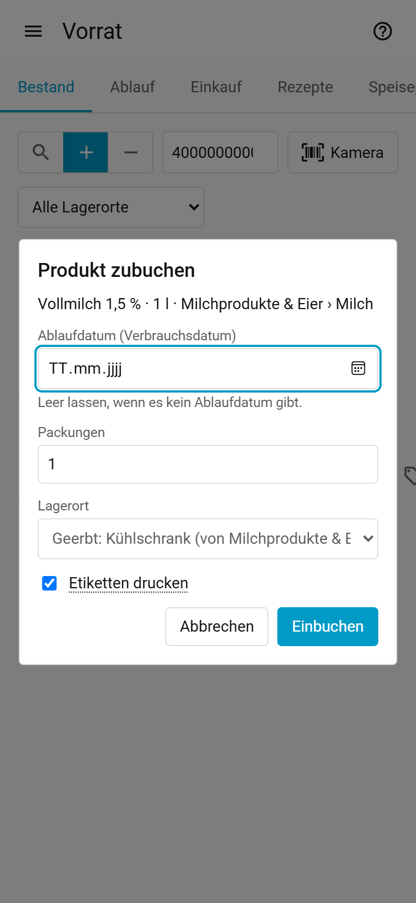
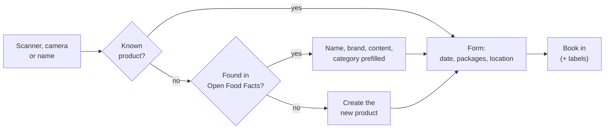
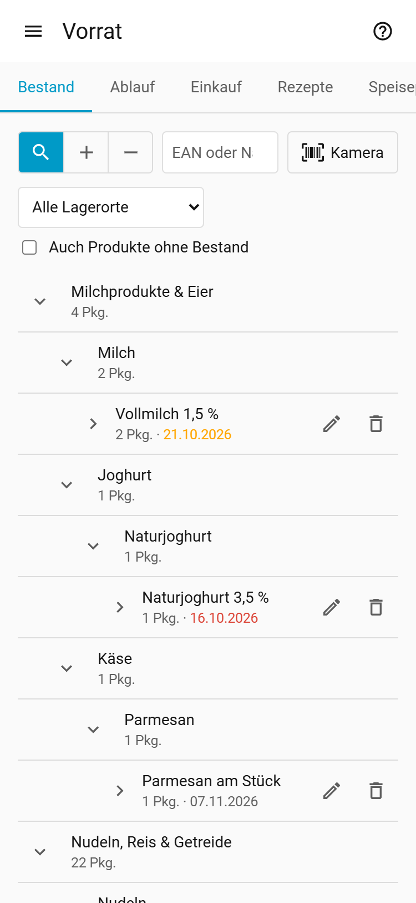
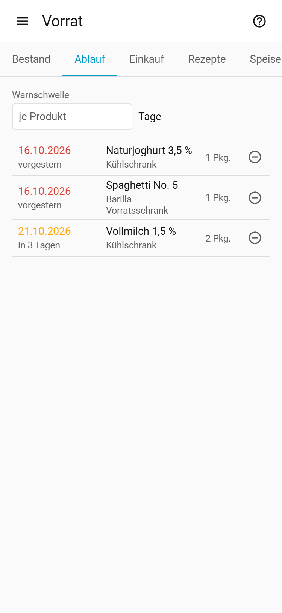
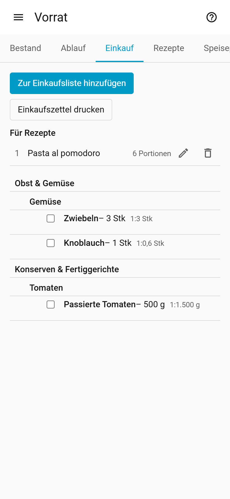
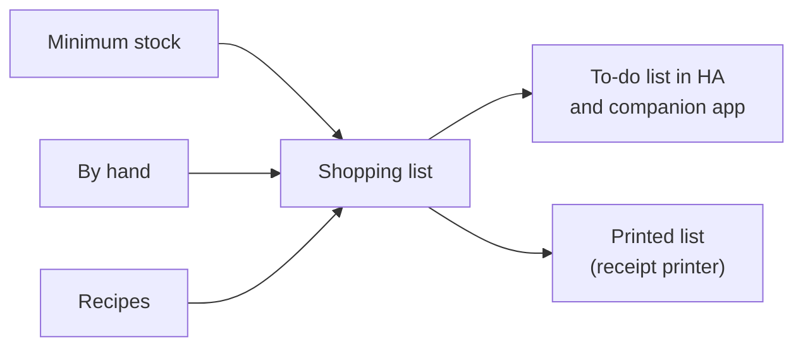
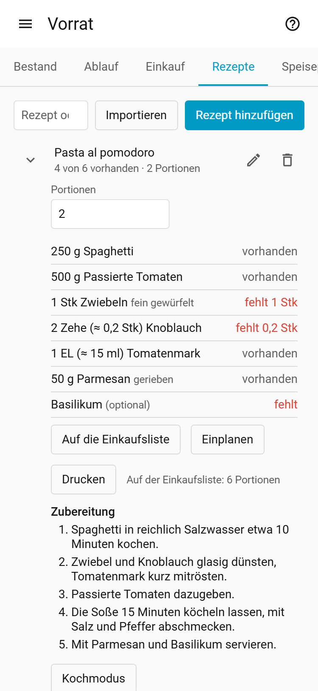
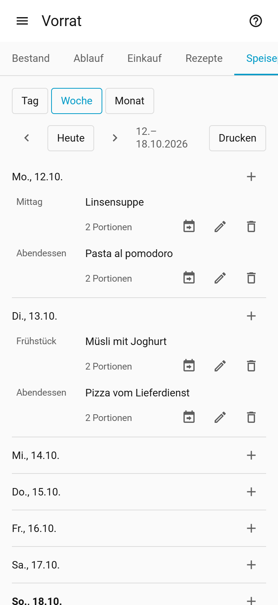
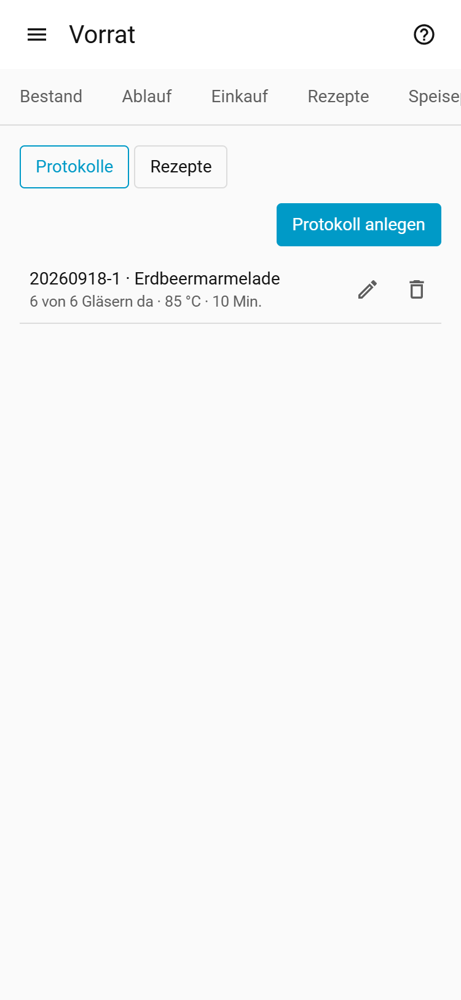
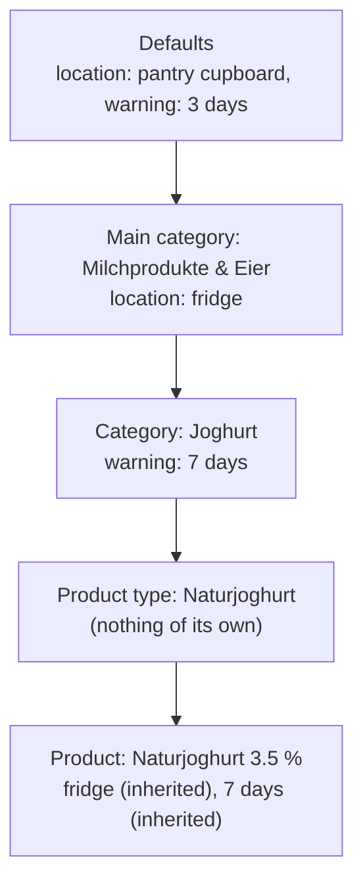

# Home Inventory (Vorrat) – User guide

*Deutsche Fassung: [guide.de.md](guide.de.md)*

Home Inventory is a household inventory inside Home Assistant. You book items in and out by barcode or name:
food, batteries, household goods, medicine and home-canned jars.
Home Inventory remembers where everything is and when it expires, reminds you of what expires soon and
keeps the shopping list from minimum stock levels, recipes and your own items. This guide explains how to use it; installation
and technical details are in the [README](../README.md).

The panel's interface is in German, so this guide names buttons and fields by their German labels
(with a translation in brackets where it helps).

Home Inventory is in the Home Assistant sidebar as *Vorrat*. The question mark at the top right
opens this guide. These are the tabs:

| Tab | For |
|---|---|
| **Bestand** (stock) | Book in, book out, search; what is where? ([2](#2-booking-in-your-shopping)–[4](#4-viewing-and-fixing-the-stock)) |
| **Ablauf** (expiry) | Expired and soon expiring items ([5](#5-what-expires-soon)) |
| **Einkauf** (shopping) | Shopping list from minimum stock, recipes and by hand ([6](#6-shopping-list)) |
| **Rezepte** (recipes) | Recipes checked against stock, import and cook mode ([7](#7-recipes)) |
| **Speiseplan** (meal plan) | Dishes by day and meal ([7a](#7a-meal-plan)) |
| **Einkochen** (canning) | Canning protocols and canning recipes ([7b](#7b-canning)) |
| **Einstellungen** (settings) | Admins only: locations, units, categories, defaults ([1](#1-getting-started), [9](#9-categories-product-types-and-inheritance)) |

## Contents

1. [Getting started](#1-getting-started)
2. [Booking in your shopping](#2-booking-in-your-shopping)
2a. [Importing a receipt](#2a-importing-a-receipt)
3. [Using up and booking out](#3-using-up-and-booking-out)
3a. [Opening a package](#3a-opening-a-package)
4. [Viewing and fixing the stock](#4-viewing-and-fixing-the-stock)
5. [What expires soon?](#5-what-expires-soon)
6. [Shopping list](#6-shopping-list)
7. [Recipes](#7-recipes)
7a. [Meal plan](#7a-meal-plan)
7b. [Canning](#7b-canning)
8. [Labels and receipt printer](#8-labels-and-receipt-printer)
9. [Categories, product types and inheritance](#9-categories-product-types-and-inheritance)
10. [Tips and FAQ](#10-tips-and-faq)

## 1. Getting started

Home Inventory comes ready to use: storage locations (Kühlschrank = fridge, Gefrierschrank = freezer,
Vorratsschrank = pantry cupboard …), units (g, kg, ml, l, Stück, Packung, EL, TL …) and a category
tree with about 1,700 product types (Tomatenmark, Spaghetti, Basmatireis …). There are also categories
for non-food (Haushalt & Drogerie, Haustechnik, Hausapotheke, Tierbedarf) and Eingekochtes
(home-canned jars).

Admins should take a quick look at **Einstellungen** first:

1. **Lagerorte** (locations): adapt the list to your household (rename, add, delete).
   The arrows button **„<Ort>“ umlagern** (move) moves all the stock of a location to another one (e.g. when
   the freezer is replaced); the location stays. The dialog first shows how many batches and packages
   will move. Batches that already exist at the target are merged.
2. **Standards** (defaults): what applies when a category or product sets nothing of its own
   (unit, location, date type, expiry warning, shelf life).
3. **Einheiten** (units): the checkbox **Nur für Rezepte** (recipe only) hides a unit (e.g. EL, tablespoon) for products, minimum stock and defaults. It stays available for recipe ingredients.
4. **Kategorien**: give categories a default location (e.g. Milchprodukte & Eier → fridge), so booking in rarely
   needs a location choice.
5. Optional: don't need everything? Under *Settings → Devices & services → Home Inventory → Configure → Module* you turn shopping list, recipes, meal plan, canning and opening packages (*Anbrechen*) off one by one (also offered during setup). The tab or button disappears, the data is kept.
6. Optional: set up a label or receipt printer (see [Labels and receipt printer](#8-labels-and-receipt-printer)).

## 2. Booking in your shopping

<picture><source media="(prefers-color-scheme: dark)" srcset="images/book-in-dark.png"></picture>

Open **Bestand** and set the switch in front of the input field to **+** (book in). Its three
buttons are the **magnifier** (search), **+** (book in) and **−** (book out); the chosen one is
filled. The input field is ready right away. The switch stays until you change it or leave the tab.

> [!TIP]
> A bookmark to `/home_inventory/in` opens the stock with **Einbuchen** (book in) already set, `/home_inventory/out`
> with **Auslagern** (book out). Handy for a kitchen tablet.

1. **Find the product**, in one of three ways:
   - Scan with a USB or Bluetooth barcode scanner; it types the barcode into the field.
   - Tap **Kamera** and hold the barcode in front of the phone camera.
   - Type a name and press <kbd>Enter</kbd>.

   A dialog opens: for a name first the hits to pick from, then the form. **Abbrechen** (cancel),
   <kbd>Esc</kbd> or a tap beside it closes it; if you already entered something, Home Inventory asks first.
2. **Known product**: only the fields for this booking appear.
   **Unknown barcode**: Home Inventory asks Open Food Facts (for non-food its sister databases Open Beauty
   Facts, Open Pet Food Facts and Open Products Facts) and prefills name, brand, content and a matching
   category. With an AI set up, it checks them right after ("KI prüft das neue Produkt …") and fixes
   name, category and content; the top line then says "Von der KI geändert: … (vorher: …)" (changed
   by the AI, before) with **Rückgängig** (undo). When no product type fits, the AI proposes a new
   one ("Neue Produktart … wird beim Einbuchen angelegt", added when you book in). Check them. If nothing is found, create the product with **Neues Produkt** (new
   product); **Online suchen** searches Open Food Facts and its sister databases by name.
3. **Kategorie**: every new product needs a category, ideally a product type (e.g. "Tomatenmark").
   Type into the filter of the category picker. If it is missing, choose **„…“ neu anlegen**
   (create) and then the parent category.
4. **Inhalt** (content, optional): e.g. 500 g per package, drained weight for cans. Minimum stock
   and recipes calculate with it.
5. **Mindestanzahl** (minimum packages, optional): below it the product goes on the shopping list.
6. **Expiry date** (Ablaufdatum): the date on the package. The label names the date type (best before or
   use by). If the category or product has a *Haltbarkeit* (shelf life), you may leave the field empty:
   Home Inventory then guesses today + shelf life (the hint below the field names the days). In the stock
   such a date shows "(geschätzt)" (guessed) until you change or confirm it in the stock row. Without a
   shelf life an empty field means no date (see [Categories](#9-categories-product-types-and-inheritance)).
   To have the guessed date already in the field, turn on **Geschätztes Ablaufdatum vorausfüllen**
   (see [Household size](#household-settings)).
7. **Packungen** (packages) and **Lagerort** (location): the location is prefilled (grey:
   "Geerbt: Kühlschrank (von Milchprodukte & Eier)" = inherited). Another choice applies to this booking
   only; **Zurücksetzen** returns to the default. For a new product **Wird Standardlager** keeps the
   chosen location as its default.
8. **Etiketten drucken** (print labels, if set up) and **Einbuchen**.

> [!NOTE]
> The same product with the same date goes into the same batch. A different date makes a new batch,
> so later you see which package has to go first.

## 2a. Importing a receipt

Instead of scanning every product, book in a whole shopping trip from its receipt. This needs an AI
set up (README, *AI*).

1. In booking in (**+** in front of the input field) choose **Kassenbon importieren** (import receipt).
2. **Bon scannen** (scan receipt): put the receipt flat on a dark surface. The camera marks its outline;
   tap **Auslösen** (take). Then you see the photo with four corner points: drag them onto the receipt's
   corners if needed and tap **Übernehmen** (apply). Home Inventory cuts out the receipt, straightens it
   and turns it black and white; the result shows as a preview. **Ohne Zuschnitt** (uncut) takes the
   photo as it is. Instead of the camera, **Oder Foto wählen** (or pick a photo) works too, with the same
   corner step. The first scan loads a few MB. Tap **Bon lesen** (read receipt). The text is recognized on your device ("Text wird erkannt …
   40 %"), then the AI reads the items ("KI liest den Bon …"). Only the text goes to the AI, not the
   photo.
3. Check the list. At the top is the **Händler** (store, editable). Each row shows the receipt text and:
   - **Produkt** (product): the recognized product. When several fit it says "Bitte wählen …" (please
     choose) and you pick one. **Neues Produkt anlegen** (new product) shows name and category for a
     new product; **Nicht einbuchen** (do not book) leaves the row out.
   - **Packungen** (packages): taken from the receipt ("2 x 1,19" = 2).
   - **Ablaufdatum** (expiry date): enter the date from the package. You may leave it empty: then
     Home Inventory guesses today + the category's shelf life (see [Booking in](#2-booking-in-your-shopping), step 6).
4. Tap **… einbuchen** (book in). All rows go to their product's default location; the top line says
   "… Pkg. vom Kassenbon eingebucht."

Home Inventory remembers per store which product you chose for a receipt line. On the next receipt of
the same store it is already selected.

## 3. Using up and booking out

Set the switch in **Bestand** to **−** (book out; as a bookmark: `/home_inventory/out`). Then it works
like booking in: scanner, camera or name, then the dialog.

- By default the package with the earliest date is taken. You can also pick a batch and location.
- **Scan a label**: a Home Inventory label (QR code) books out one package of that batch, whether
  the switch is on Einbuchen or Auslagern (on Anbrechen it opens one, see 3a).
- **Rückgängig** (undo) next to the message puts the packages back where they were, once per
  booking.
- In **Bestand** and **Ablauf** the minus on a batch takes one package out of exactly that batch.

> [!NOTE]
> Cooking a recipe books nothing out automatically; book out the ingredients as usual.

## 3a. Opening a package

Milk, jam or pesto do not keep until the printed date once opened. Mark the package as opened when
you open it, and Home Inventory uses the shorter date.

- **In Bestand**: tap the open box icon (**Anbrechen**, open) on the batch. It opens exactly one
  package of that batch at that location.
- **By scan**: set the switch to the open box (Anbrechen; as a bookmark: `/home_inventory/open`). A scanned
  Home Inventory label opens a package of that batch; a barcode or name opens the package with the
  earliest date.
- **By automation**: action `home_inventory.open_package` (see [README](../README.md#services-automations)).

The opened package gets its own row "… · angebrochen am …" (opened on) and expires after the
*Haltbar nach Anbruch* (shelf life after opening) of its category or product (e.g. milk 3 days), never
later than the printed date. If nothing is set there (pasta), the date stays. It still counts toward the
stock and the minimum stock; **Ablauf**, the sensors and the recipe suggestions use the new date.
Booking out and label scans take the opened package first.

After opening, next to the message:

- **Rückgängig** (undo): makes the package unopened again (once, while it is still in stock).
- **Etikett drucken** (print label): opens the label dialog with the new date. Nothing is printed
  until you press **Drucken** there, never automatically.

## 4. Viewing and fixing the stock

<picture><source media="(prefers-color-scheme: dark)" srcset="images/stock-dark.png"></picture>

**Bestand** shows the category tree with everything in stock, with counts and the earliest date.

- Tap a row to open it. A product shows its batches (date, location, packages).
- The input field filters the list while you type: name, brand, barcode, category and location.
  With the switch on the **magnifier** (search), <kbd>Enter</kbd> opens no dialog, so you can find a product with the
  scanner to edit it without booking anything.
- **Alle Lagerorte** filters by location. **Auch Produkte ohne Bestand** also shows products with
  no stock, to edit or delete them.
- **Pencil on a product**: name, brand, barcode, category, content, minimum packages and own
  defaults (location, date type, expiry warning).
- **Pencil on a batch**: fix the date or the package count, e.g. after a typo; 0 packages removes
  the batch.
- **Tag icon**: reprint labels for this batch.
- Canned jars show their charge next to the date.
- Red means expired, orange means expiring soon.

## 5. What expires soon?

<picture><source media="(prefers-color-scheme: dark)" srcset="images/expiry-dark.png"></picture>

**Ablauf** lists all expired (red) and soon expiring (orange) batches, earliest first. "Soon" means
within the product's *Warnung vor Ablauf* (expiry warning, own or inherited). **Warnschwelle**
temporarily sets one value for all, e.g. 14 days for meal planning; nothing is saved.

Below, **Rezepte für Ablaufendes** (recipes for expiring items) suggests recipes that use up expiring or
expired food (same threshold as the list, including the temporary one). Recipes using the most expiring
ingredients come first, then the one with more ingredients in stock. Tap one to open the recipe. In the
**Rezepte** tab such a recipe is marked "Ablaufendes: n"; *Nur mit Ablaufendem* (only with expiring
items) filters on it.

> [!TIP]
> For automations there are the sensors *Abgelaufen* (expired) and *Läuft bald ab* (expiring
> soon), see the [README](../README.md#sensors), e.g. for a phone notification.

## 6. Shopping list

<picture><source media="(prefers-color-scheme: dark)" srcset="images/shopping-dark.png"></picture>

The shopping list in the **Einkauf** tab is fed from three sources:

- **Minimum stock**: on categories (settings) you set a *Mindestmenge* (amount, e.g. 2 kg pasta of
  any brand) and/or a *Mindestanzahl* (packages). A product can have its own *Mindestanzahl* for
  favourite products. When something is missing it appears on the list: "Nudeln – 500 g fehlen" or
  "Barilla · 2 Pkg. fehlen". Minimums count the whole category including subcategories, and nothing
  is counted twice.
- **By hand**: **Zur Einkaufsliste hinzufügen**, type a name, pick a product or category, set the
  count. A new product is created on the spot.
- **From recipes**: in a recipe tap **Auf die Einkaufsliste** (put on the shopping list), choose the
  servings and the optional ingredients you need. The missing amounts of all recipes are added up per
  category. The recipes are numbered 1, 2, 3 …; after each item, in smaller text, is which recipe needs how much ("1:300 g; 2:200 g"). A recipe stays on the
  list until you remove it: in the **Einkauf** tab under **Für Rezepte**, use the bin, e.g. after
  cooking. Change servings or optional ingredients there with the pencil.

  Amounts in recipe units such as EL, Tasse or Prise are converted like this:

  | Case | Result | Example |
  |---|---|---|
  | unit fits the category | ml for volume, g for weight | 3 EL oil → 45 ml |
  | does not fit, nothing of it in stock | the unit's base unit | 2 EL capers → 30 ml |
  | Scheibe (slice) | stays as written | 2 Scheiben |
  | no amount | 1 package | salt → 1 Pkg. |

Ticking strikes an item through. A minimum stock item is unticked by itself when the missing amount
changes, e.g. after buying only part of it.

The same list is the to-do list **Einkaufsliste** in Home Assistant and the companion app. You can
tick items there and add items by the exact name of a product or category (the entity is
`todo.vorrat_einkaufsliste`). **Erledigte entfernen** (remove completed) there only deletes ticked items
added by hand; minimum stock items stay until the stock is there.

**Einkaufszettel drucken** (print shopping list): with a receipt printer this button prints all
unticked items, sorted by main category, and cuts the paper. It only shows when a receipt printer is
set up (see [Labels and receipt printer](#8-labels-and-receipt-printer)).

## 7. Recipes

<picture><source media="(prefers-color-scheme: dark)" srcset="images/recipe-dark.png"></picture>

**Rezepte** shows all recipes with "5 von 7 vorhanden" (5 of 7 in stock). The search finds names
and ingredients. Opening a row shows the ingredients with their status, the numbered steps, source and
image; **Portionen** (servings) scales the amounts (display only). **Auf die Einkaufsliste** (put on
the shopping list) adds the recipe's missing amounts (see [Shopping list](#6-shopping-list)). **Einplanen** (plan) adds it to the
[meal plan](#7a-meal-plan) with the shown servings (date: today, meal: Abendessen/dinner, both changeable in the dialog).

Canning recipes are not listed here; they are in the **Einkochen** (canning) tab, view **Rezepte**
(see [Canning](#7b-canning)). They are never offered in the meal plan.

**Rezept hinzufügen** (add recipe):

1. Enter name and servings.
2. For each ingredient search a product type or category in **Zutat** (a product name works too:
   "Mutti" finds Tomatenmark). If it is missing, **Neue Produktart „…“ anlegen**.
3. Amount and unit (both or neither), optionally a **Hinweis** (note) such as "fein gewürfelt".
4. **optional** for ingredients the recipe can do without; **Nicht gegen den Vorrat prüfen** (do
   not check against the stock) for things you do not keep in the inventory (salt, water).
5. If a unit is missing, choose **Neue Einheit …** in the unit select.
6. Under **Zubereitung** (preparation) add the steps with **Schritt hinzufügen**, one per field. The
   arrows move a step, the cross removes it. **Zwischenüberschrift hinzufügen** (add heading) splits
   the recipe into parts (e.g. "Teig", "Füllung"); numbering runs on.

> [!NOTE]
> Older recipes still have a single instructions text. The next time you edit one, the dialog shows
> it split into steps at blank lines; saving turns it into the step list.

**Drucken** (print): with a receipt printer this button in an open recipe prints name, servings,
the ingredients to tick off (amounts for the shown servings) and the numbered steps. It only shows
when a receipt printer is set up.

**Kochmodus** (cook mode): in an open recipe, **Kochmodus** shows the ingredients (for the shown
servings) and the steps full screen. A tap ticks a step off (not saved). A step that mentions a time
("20 Minuten", "ca. 10–15 Min.", "eine halbe Stunde") gets a timer button; a range uses its upper
value. Several timers can run at once and are listed at the bottom; a finished one beeps, vibrates
and turns red. The screen stays on while the cook mode is open (if the browser allows it).

> [!WARNING]
> Timers only run in this browser window. Closing asks first and ends them.

Units marked *Nur für Rezepte* (recipe only, e.g. EL, TL, Tasse, Prise) are offered only here. If the unit has a base amount, the recipe shows it too: "3 EL (≈ 45 ml)". Sizes are rules of thumb:

| Unit | Size |
|---|---|
| Tasse (cup) | 250 ml |
| Prise, Messerspitze (pinch) | 0.5 g |
| Zehe (clove) | 0.1 piece (the shopping list rounds up: 3 Zehen → 1 Knoblauch) |
| Handvoll (handful) | 30 g |
| Tropfen (drop) | 0.05 ml |
| Spritzer (dash) | 1 ml |
| Schuss (splash) | 20 ml |
| Zweig, Stiel (sprig, stalk) | 0.1 Bund (bunch) |
| Scheibe (slice) | no size, stays as written on the shopping list ("2 Scheiben") |

A unit created by a recipe import starts as recipe-only.

**Importieren** (import): paste the address of a recipe (e.g. Chefkoch, Mealie, Tandoor). Home Inventory
reads the page's recipe data and opens the recipe dialog prefilled, with the page's steps (a single
text block is split at its line breaks or its own numbering); nothing is saved until you
save. Each ingredient shows its original line; check the suggested product types. An unknown unit
(e.g. "Tasse", cup) is created with **Anlegen** or replaced by an existing one.

**Recipe from Instagram, TikTok, YouTube, text or a photo** (if an AI is set up): at the top of the
import dialog you pick the source.

- **Link**: when the page has no recipe data (Instagram reel, TikTok, YouTube short, a blog), the AI
  reads the post: caption, video (also spoken words and on-screen text) or image. Get the link in the
  app with *Share > Copy link*.
- **Text**: paste a recipe text, e.g. from a message; the AI sorts it into ingredients and steps.
- **Foto** (photo): a photo of a cookbook page or a screenshot; **Foto aufnehmen** (take photo) opens the camera.

**Importieren** shows "Rezept wird gelesen …" (reading); with the AI it takes up to a minute. Then
the recipe dialog opens as for any import (with the AI check). When the AI finds no recipe or fails,
the import dialog stays open with your input. Instagram often refuses videos without login; then the
AI only reads the caption and the image. When the recipe is only in the video, use the TikTok or
YouTube link if the post is there too.

**AI check** (if set up, see below): right after the dialog opens the AI checks the import. The top
line says "KI prüft das Rezept …" (checking); saving waits, **Nicht abwarten** (do not wait) skips
the check. Afterwards it says "keine Änderungen" (no changes) or what the AI changed: ingredients
with a better category or unit are marked ("Von der KI geändert: … (vorher: …)", with
**Rückgängig** / undo); a new unit the AI proposes is added with **Anlegen** (create). A long text block is split into steps (**Schritte zurücksetzen** restores it). When the
category tree has no fitting product type (e.g. a rare spice), the AI proposes a new one below the
right category ("KI schlägt neue Produktart … vor"); it is only added when you save, **Rückgängig**
drops the proposal. Check the
changes before saving. If the AI fails, the draft stays as imported.

Home Inventory remembers the category you saved for an imported ingredient: the next import of the same
ingredient gets it directly. It also remembers when you change the category Open Food Facts
suggested while booking in.

**Set up the AI** (admin, once):

1. Set up an AI with an *AI Task* in Home Assistant, e.g. *Settings > Devices & services > Add
   integration > Google Gemini* with an API key from Google AI Studio (there is a free tier).
2. *Settings > Devices & services > Home Inventory > Configure > KI (Rezeptimport, Assistenten)*: pick the
   AI Task. Empty = no AI.

> [!IMPORTANT]
> Each import sends the recipe and the food category tree to the chosen AI (about 10,000 tokens);
> reading a post also sends its video or image.

**With an AI assistant** (Assist, Claude Desktop through MCP): ask e.g. "What expires this week?",
"What can I cook from my stock?" or "Put milk on the shopping list". Set up (admin):

1. In the Assist agent (e.g. *Google Gemini > Configure*) tick the LLM API **Home Inventory** under
   *Control Home Assistant*, or in the *Model Context Protocol Server* integration.
2. Under *Configure > KI (Rezeptimport, Assistenten) > Zugriff für Assistenten* choose what it may do:
   *Nur lesen* (read only), *Lesen, Einkaufsliste und Speiseplan* (read, shopping list and meal plan;
   default) or *Alles, auch Ein- und Ausbuchen und Anbrechen* (everything, including booking and
   opening packages).

Name products, recipes and locations as they are called in Home Inventory.

Ingredient status: *vorhanden* (in stock), *teilweise* (partly), *fehlt* (missing), *Menge
unbekannt* (products without content), *keine Zutat zugeordnet* (not matched), *nicht geprüft* (not
checked).

## 7a. Meal plan

<picture><source media="(prefers-color-scheme: dark)" srcset="images/plan-dark.png"></picture>

**Speiseplan** (meal plan) shows the plan as **Tag** (day), **Woche** (week) or **Monat** (month), buttons at the top. **Zurück** (previous) and **Weiter** (next) move by a day, a week or a month, depending on the view; **Heute** (today) jumps to today's date. The tab opens on today; switching the view keeps the chosen date.

- **Woche**: a table with one row per meal and one equal-width column per day. On a phone each day becomes a block that shows only its dishes, plus a **+**. Tapping a day heading opens that day.
- **Tag**: a list grouped by meal, with a **+** per meal.
- **Monat**: a calendar grid with a small icon per planned dish (the name appears on hover or long press). Tapping a day opens its day view.

**Mahlzeit** (meal): every dish belongs to a meal: Frühstück (breakfast), Mittag (lunch), Kaffee (coffee), Abendessen (dinner) or Snack. Within a day, dishes are ordered by meal, then in the order they were added.

**Gericht hinzufügen** (add dish, **+** at the meal):

1. Pick a recipe from the list of names, or type free text (e.g. "Pizza from the delivery service"). A recipe is planned for Abendessen (dinner) by default; change it in the dialog if needed.
2. **Portionen** (servings) starts with the household size (see below); change it if this dish is for more or fewer people.
3. Save.

Tapping the name opens the recipe (free text: the edit dialog). The pencil changes a dish, the bin deletes it. Deleting a recipe keeps its dishes in the plan as free text; the delete question lists them.

**Umplanen** (shift): the arrow icon on a dish moves that dish's meal on this day and on every directly following day that has the same meal planned, one day later. The shift stops at the first day without that meal (the gap). Other meals stay where they are. A confirmation lists every dish with its old and new date; only **Verschieben** (move) applies it.

**Drucken** (print): in **Tag** and **Woche** this button prints the day or the week (Monday to Sunday) on the receipt printer, each day with all its dishes. It only shows with a receipt printer; the month does not fit a receipt.

**Einkaufsliste** (shopping list): this button opens a dialog with **Von** (from) and **Bis** (to), by default today to six days later. **Auf die Liste** (onto the list) puts every recipe planned in that range on the shopping list with the servings of all its meals added up; what is in stock is subtracted, as for [recipes on the list](#6-shopping-list). Free-text dishes are skipped, and a recipe already on the list keeps the larger servings. **Bis** may not be before **Von** (at most 366 days). A line above the plan names what was added. There is no consumption forecast yet.

**Mahlzeiten** (meal times, admins only): under *Einstellungen > Mahlzeiten* set from when each meal counts (default: Frühstück 05:00, Mittag 11:00, Kaffee 14:30, Abendessen 17:00, Snack 20:30). The action *Geplantes Rezept drucken* (print planned recipe) uses it when no meal is given, e.g. a button in the kitchen that prints the recipe for the next meal.

**Household size** (admins only): in *Settings > Devices & services > Home Inventory > Configure*, step **Haushalt** (menu *Einstellungen*), set **Portionen im Haushalt** (1 to 99, default 3). It is the servings default for new dishes. Same step: **Geschätztes Ablaufdatum vorausfüllen** (fill in the guessed expiry date, default off) puts today + shelf life into the date field when booking in; off, the field stays empty and the date is guessed only when saving. **Produkte in Open Food Facts nachschlagen** (default on): off, an unknown barcode is not looked up and *Online suchen* is gone; you create new products by hand.

**Calendar**: the plan is also a read-only calendar in Home Assistant, entity *Speiseplan*. Each dish is an all-day event titled "Mahlzeit: Gericht" (e.g. "Mittag: Spaghetti"); its description shows the servings. Change the plan in the panel.

## 7b. Canning

<picture><source media="(prefers-color-scheme: dark)" srcset="images/canning-dark.png"></picture>

Home-canned jars (jam, compote, pickles …) are booked in with a **canning protocol** (Einkochprotokoll).
Each protocol gets a charge. The labels carry it, so scanning a label books out exactly one jar of that charge.

The **Einkochen** (canning) tab has two views, buttons at the top: **Protokolle** (protocols) and **Rezepte** (recipes).

**Protokolle** lists the protocols, newest first, with charge, product, jars (made and still in stock),
temperature and duration.

**Protokoll anlegen** (add protocol):

1. Open the **Einkochen** tab, view **Protokolle**, and tap **Protokoll anlegen**.
2. **Einkochrezept** (canning recipe, optional): with a recipe the product is fixed to the recipe's product
   (shown as **Ergibt: …**), and **Gläser**, **Temperatur** and **Dauer** are prefilled from it. You can change them.
3. Without a recipe, **Produkt** (product): pick an existing product by name, or type a new name and choose a
   **Kategorie** (category, e.g. under *Eingekochtes*).
4. **Hergestellt am** (made on): today is prefilled; change it if you canned on another day.
5. **Gläser** (jars, count) and **Lagerort** (location).
6. **Haltbar bis** (best before): Home Inventory proposes made-on date + shelf life; changeable.
7. Check **Temperatur** (°C) and **Dauer** (minutes); **Notizen** (notes) are optional.
8. **Speichern** (save): Home Inventory creates the charge by itself, code `YYYYMMDD-n` (e.g. `20261018-1`; n is
   the running number of that day). The jars are booked in as their own batch; then you can print one
   label per jar.

**Edit a protocol**: the pencil changes only the recipe, temperature, duration, notes and **Haltbar bis**.

> [!NOTE]
> Made-on date, product and jars stay, since the labels carry them.

**Rezepte** (view in the **Einkochen** tab) lists only canning recipes, with the same list, search, import
and editing as the recipe list. **Einkochrezept anlegen** (add canning recipe) opens the recipe dialog:

- **Name**, **Zubereitung** (steps), source and image link, ingredients as for normal recipes.
- **Ergibt Produkt** (yields product, required): an existing product by name, or a new name with a **Kategorie**.
- **Ergibt (Gläser)** (yields jars) instead of portions: the ingredients scale by jars.
- **Temperatur** (°C) and **Dauer** (minutes): optional, both or neither.

So every canning recipe yields a defined product. Opening one shows "ergibt N × Produkt" and the button
**Protokoll anlegen**, which switches to **Protokolle** with that recipe chosen. Deleting a product also
deletes the canning recipes that yield it (the delete question lists them).

**Delete a protocol** (admins only): the bin removes the protocol with its stock and bookings, after the
usual question.

**Jars without a protocol**: jars canned earlier that you did not log are booked in like any product
(category *Eingekochtes*), without a charge.

**Labels**: the label shows the charge in its brand line. The QR code contains it, so a scan in **Bestand**
(switch on Einbuchen or Auslagern) books out a jar of that charge.

## 8. Labels and receipt printer

A label shows product, brand, expiry date and a QR code of the batch, so every package says what is
inside and how long it keeps, also repacked, frozen or home-canned food without a printed date.
Scanning the label books the package out.

- **Setup** (admin): *Settings > Devices & services > Home Inventory > Configure > Etikettendrucker*. Choose the model, e.g.
  *Dymo LabelWriter 450*, then under **Drucker** the address of the USB print server or the device
  path (USB on the Home Assistant machine, e.g. `/dev/usb/lp0`) and the label size. With *Kein Drucker*
  the browser's print dialog opens.
- **When booking in**: tick **Etiketten drucken**, one label per package (at most 20).
- **Reprint**: tag icon on a batch in Bestand.
- **Canning labels** show the charge instead of a brand in the brand line (see [Canning](#7b-canning)).
- Printing more than 2 labels at once asks first.

**Receipt printer** (for the shopping list, recipes and meal plan): *Settings > Devices & services > Home Inventory > Configure >
Bondrucker*. **Drucker** is the device path (USB on the Home Assistant machine, e.g.
`/dev/bondrucker`) or the network address; also paper width, cutting and, for serial printers, the
baud rate. **Testbon drucken** checks the connection when you save. The technical setup (passing USB
into Docker) is in the [README](../README.md#receipt-printer-bondrucker).

## 9. Categories, product types and inheritance

The category tree has three levels: **main category → category → product type (Produktart)**,
e.g. *Nudeln, Reis & Getreide → Nudeln → Spaghetti*. Products usually belong to a product type.
Recipes and minimum stock work with categories and product types, not with brands.

**Food or not** (*Lebensmittel*): every category has this field, either "Lebensmittel" (food) or
"Kein Lebensmittel" (not food). It is inherited. Non-food is never offered as a recipe ingredient.

Home Inventory comes with these main categories (existing installations get the missing ones):

- **Haushalt & Drogerie**, **Haustechnik** (home technical supplies: categories Batterien with AA, AAA, C,
  D, 9V and button cells; Akkus, rechargeable; Leuchtmittel, lamps by socket such as E27, E14, GU10),
  **Tierbedarf** (pet supplies): non-food.
- **Hausapotheke** (home medicine): non-food, date type "verbrauchen bis" (use by), warning 30 days.
- **Eingekochtes** (home-canned: Obst & Kompott, Marmelade & Gelee, Gemüse & Eingelegtes, Soßen & Suppen,
  Fleisch & Wurst): shelf life 365 days, warning 30 days.

**Inheritance**: unit, default location, date type, expiry warning and shelf life apply to everything below
until a lower level or the product sets its own. An example:

Inherited values are grey with their source, in the example
"Geerbt: 7 Tage (von Joghurt)". **Zurücksetzen** removes an own value, then the inherited
one applies again. Minimum stock is not inherited.

**Expiry date and shelf life**: bought goods carry their date on the package, and that date counts.
Without a printed date, or when you do not want to type it, the *Haltbarkeit* (shelf life in days, the
usual shelf life from purchase, seeded for the food categories) counts: an empty date at book-in becomes
today + shelf life ("geschätzt", guessed), a canning protocol proposes made-on date + shelf life. Without
a shelf life nothing is guessed. The date stays editable everywhere.

**Haltbar nach Anbruch** (shelf life after opening): days an opened package still keeps (see 3a),
inherited like the shelf life. Empty means opening does not change the date.

**Deleting**: before deleting, Home Inventory lists what goes with it or changes (subcategories, products,
stock, recipe ingredients …). Deleting a location with stock asks where its packages should go.

## 10. Tips and FAQ

<b>What does a field mean?</b>

Labels with a dotted underline explain themselves when you hover the mouse over them; icon buttons name their action the same way. Phones show no tooltips, which is what this guide is for.

<b>The camera does not start.</b>

Camera scanning needs HTTPS (or `localhost`) and camera permission in the browser or app. Browsers without a built-in barcode detector (iPhone, Firefox, Windows) load a bundled decoder on first use; nothing is loaded from external servers.

<b>Unknown barcode.</b>

Not every product is in Open Food Facts. Create it with **Neues Produkt**; the next scan knows it.

<b>Who may do what?</b>

All users book, edit products, keep the shopping list and recipes, and may add product types and units. Settings, deleting products, deleting recipes and deleting canning protocols are for admins.

<b>Booked wrongly?</b>

Right after the booking use **Rückgängig**, otherwise fix the batch with the pencil in Bestand.

<b>Automations</b>

For scanners on ESPHome, NFC tags, voice commands etc. there are actions for booking (`home_inventory.book_in`, `home_inventory.book_out`), printing (`home_inventory.print_labels`, `home_inventory.print_shopping_list`, `home_inventory.print_recipe`, `home_inventory.print_plan`, `home_inventory.print_planned`), the shopping list (`home_inventory.shop_recipe`), the meal plan (`home_inventory.plan_meal`, `home_inventory.plan_to_shopping_list`) and canning (`home_inventory.canning`) (see [README](../README.md#services-automations)).

