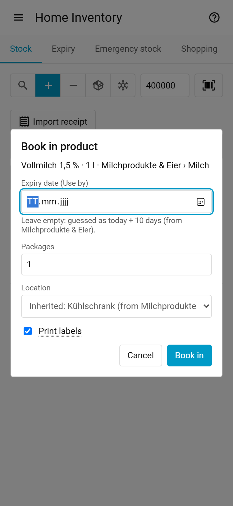
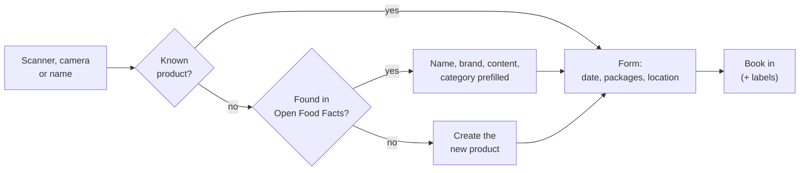
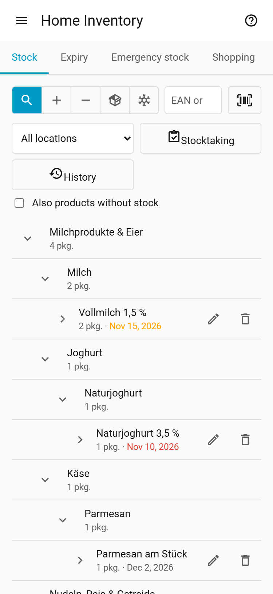
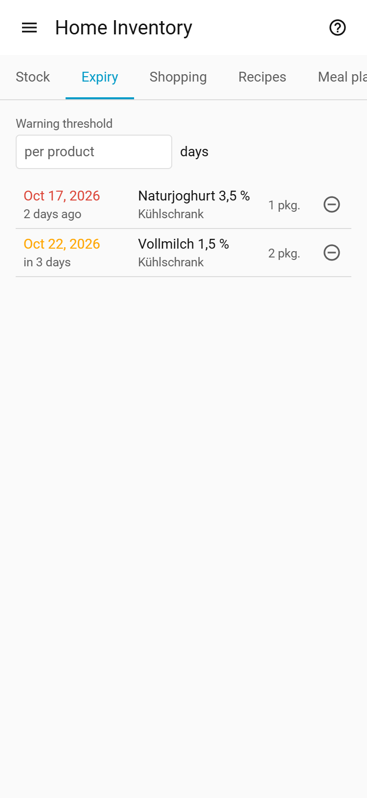
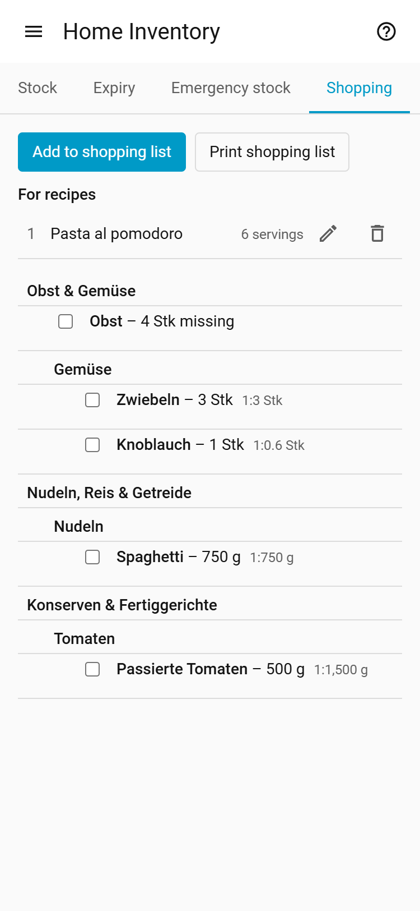
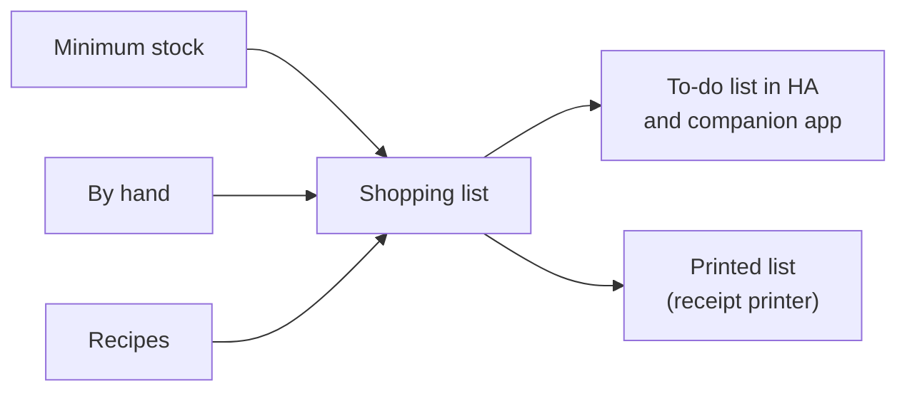
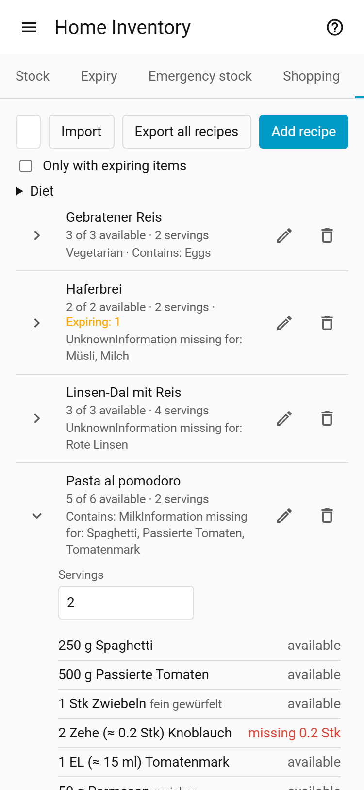
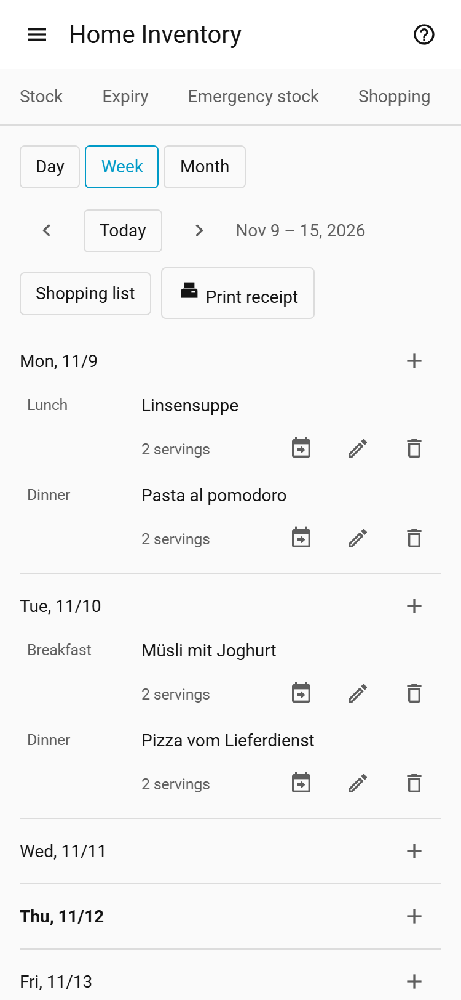
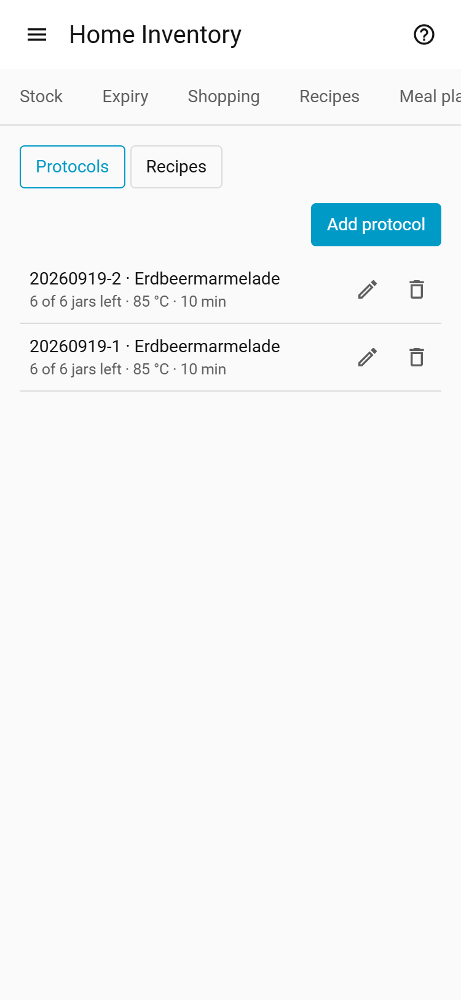
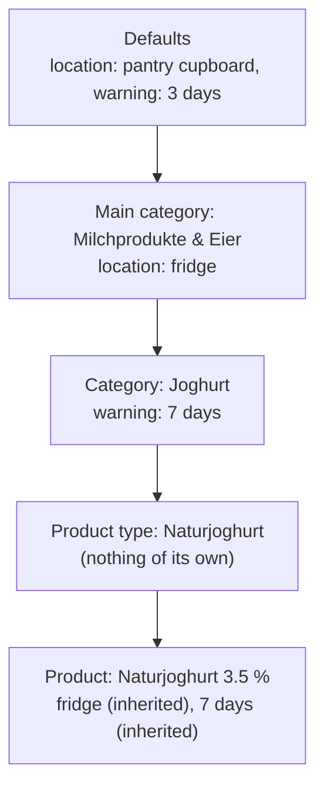

# Home Inventory (Vorrat) – User guide

*Deutsche Fassung: [guide.de.md](guide.de.md)*

Home Inventory is a household inventory inside Home Assistant. You book items in and out by barcode or name:
food, batteries, household goods, medicine and home-canned jars.
Home Inventory remembers where everything is and when it expires, reminds you of what expires soon and
keeps the shopping list from minimum stock levels, recipes and your own items. This guide explains how to use it; installation
and technical details are in the [README](../README.md).

The panel follows your Home Assistant language (German or English; any other language gets
English). Categories, units and locations are your own data: the ones set up at the start are German.

Home Inventory is in the Home Assistant sidebar as *Home Inventory*. The question mark at the top right
opens this guide. These are the tabs:

| Tab | For |
|---|---|
| **Stock** | Book in, book out, search; what is where? ([2](#2-booking-in-your-shopping)–[4](#4-viewing-and-fixing-the-stock)) |
| **Expiry** | Expired and soon expiring items ([5](#5-what-expires-soon)) |
| **Shopping** | Shopping list from minimum stock, recipes and by hand ([6](#6-shopping-list)) |
| **Recipes** | Recipes checked against stock, import and cook mode ([7](#7-recipes)) |
| **Meal plan** | Dishes by day and meal ([7a](#7a-meal-plan)) |
| **Preserving** | Canning, drying and leftover protocols and their recipes ([7b](#7b-canning-and-drying)) |
| **Settings** | Admins only: locations, units, categories, defaults ([1](#1-getting-started), [9](#9-categories-product-types-and-inheritance)) |

## Contents

1. [Getting started](#1-getting-started)
2. [Booking in your shopping](#2-booking-in-your-shopping)
2a. [Importing a receipt](#2a-importing-a-receipt)
3. [Using up and booking out](#3-using-up-and-booking-out)
3a. [Opening a package](#3a-opening-a-package)
3b. [Freezing and thawing](#3b-freezing-and-thawing)
4. [Viewing and fixing the stock](#4-viewing-and-fixing-the-stock)
4a. [Stocktaking](#4a-stocktaking)
4b. [History](#4b-history)
5. [What expires soon?](#5-what-expires-soon)
5a. [Emergency stock](#5a-emergency-stock)
6. [Shopping list](#6-shopping-list)
7. [Recipes](#7-recipes)
7a. [Meal plan](#7a-meal-plan)
7b. [Canning and drying](#7b-canning-and-drying)
8. [Labels and receipt printer](#8-labels-and-receipt-printer)
9. [Categories, product types and inheritance](#9-categories-product-types-and-inheritance)
9a. [Import and export](#9a-import-and-export)
10. [Tips and FAQ](#10-tips-and-faq)

## 1. Getting started

Home Inventory comes ready to use: storage locations (Kühlschrank = fridge, Gefrierschrank = freezer,
Vorratsschrank = pantry cupboard …), units (g, kg, ml, l, Stück, Packung, EL, TL …) and a category
tree with about 1,700 product types (Tomatenmark, Spaghetti, Basmatireis …). There are also categories
for non-food (Haushalt & Drogerie, Haustechnik, Hausapotheke, Tierbedarf) and Eingekochtes
(home-canned jars).

Admins should take a quick look at **Settings** first:

1. **Locations**: adapt the list to your household (rename, add, delete).
   The arrows button **Move “<location>”** moves all the stock of a location to another one (e.g. when
   the freezer is replaced); the location stays. The dialog first shows how many batches and packages
   will move. Batches that already exist at the target are merged.
2. **Defaults**: what applies when a category or product sets nothing of its own
   (unit, location, date type, expiry warning, shelf life).
3. **Units**: the checkbox **Recipes only** hides a unit (e.g. EL, tablespoon) for products, minimum stock and defaults. It stays available for recipe ingredients.
4. **Categories**: give categories a default location (e.g. Milchprodukte & Eier → fridge), so booking in rarely
   needs a location choice.
5. Optional: don't need everything? Under *Settings → Devices & services → Home Inventory → Configure → Modules* you turn shopping list, recipes, meal plan, canning, leftovers, opened packages and freezing off one by one (also offered during setup). The tab or button disappears, the data is kept.
6. Optional: set up a label or receipt printer (see [Labels and receipt printer](#8-labels-and-receipt-printer)).

## 2. Booking in your shopping

<picture><source media="(prefers-color-scheme: dark)" srcset="images/book-in-en-dark.png"></picture>

Open **Stock** and set the switch in front of the input field to **+** (book in). Its three
buttons are the **magnifier** (search), **+** (book in) and **−** (book out); the chosen one is
filled. The input field is ready right away. The switch stays until you change it or leave the tab.

> [!TIP]
> A bookmark to `/home_inventory/in` opens the stock with **Book in** already set, `/home_inventory/out`
> with **Book out**. Handy for a kitchen tablet.

1. **Find the product**, in one of three ways:
   - Scan with a USB or Bluetooth barcode scanner; it types the barcode into the field.
   - Tap **Camera** and hold the barcode in front of the phone camera.
   - Type a name and press <kbd>Enter</kbd>.

   A dialog opens: for a name first the hits to pick from, then the form. **Cancel**,
   <kbd>Esc</kbd> or a tap beside it closes it; if you already entered something, Home Inventory asks first.
2. **Known product**: only the fields for this booking appear.
   **Unknown barcode**: Home Inventory asks Open Food Facts (for non-food its sister databases Open Beauty
   Facts, Open Pet Food Facts and Open Products Facts) and prefills name, brand, content and a matching
   category. With an AI set up, it checks them right after ("The AI checks the new product …") and fixes
   name, category and content; the top line then says "Changed by the AI: … (before: …)" with
   **Undo**. When no product type fits, the AI proposes a new
   one ("Neue Produktart … wird beim Einbuchen angelegt", added when you book in). Check them. If nothing is found, create the product with **New product** (new
   product); **Search online** searches Open Food Facts and its sister databases by name.
3. **Category**: every new product needs a category, ideally a product type (e.g. "Tomatenmark").
   Type into the filter of the category picker. If it is missing, choose **Create “…”**
   (create) and then the parent category.
4. **Content** (optional): e.g. 500 g per package, drained weight for cans. Minimum stock
   and recipes calculate with it.
5. **Minimum count** (optional): below it the product goes on the shopping list.
6. **Expiry date**: the date on the package. The label names the date type (best before or
   use by or guide value). If the category or product has a *Shelf life*, you may leave the field empty:
   Home Inventory then guesses today + shelf life (the hint below the field names the days). In the stock
   such a date shows "(guessed)" until you change or confirm it in the stock row. Without a
   shelf life an empty field means no date (see [Categories](#9-categories-product-types-and-inheritance)).
   To have the guessed date already in the field, turn on **Fill in the guessed expiry date**
   (see [Household size](#household-settings)).
7. **Packages** and **Location**: the location is prefilled (grey:
   "Inherited: Kühlschrank (from Milchprodukte & Eier)"). Another choice applies to this booking
   only; **Reset** returns to the default. For a new product **Becomes default location** keeps the
   chosen location as its default.
8. **Print labels** (if set up) and **Book in**.

> [!NOTE]
> The same product with the same date goes into the same batch. A different date makes a new batch,
> so later you see which package has to go first.

## 2a. Importing a receipt

Instead of scanning every product, book in a whole shopping trip from its receipt. This needs an AI
set up (README, *AI*).

1. In booking in (**+** in front of the input field) choose **Import receipt**.
2. **Scan receipt**: put the receipt flat on a dark surface. The camera marks its outline;
   tap **Capture**. Then you see the photo with four corner points: drag them onto the receipt's
   corners if needed and tap **Apply**. Home Inventory cuts out the receipt, straightens it
   and turns it black and white; the result shows as a preview. **Without cropping** takes the
   photo as it is. Instead of the camera, **Or choose a photo** works too, with the same
   corner step. The first scan loads a few MB. Tap **Read receipt**. The text is recognized on your device ("Text wird erkannt …
   40 %"), then the AI reads the items ("KI liest den Bon …"). Only the text goes to the AI, not the
   photo.
3. Check the list. At the top is the **Store** (editable). Each row shows the receipt text and:
   - **Product**: the recognized product. When several fit it says "Please choose …" and you
     pick one. **Create new product** shows name and category for a
     new product; **Do not book in** leaves the row out.
   - **Packages**: taken from the receipt ("2 x 1,19" = 2).
   - **Expiry date**: enter the date from the package. You may leave it empty: then
     Home Inventory guesses today + the category's shelf life (see [Booking in](#2-booking-in-your-shopping), step 6).
4. Tap **Book in …**. All rows go to their product's default location; the top line says
   "… Pkg. vom Kassenbon eingebucht."

Home Inventory remembers per store which product you chose for a receipt line. On the next receipt of
the same store it is already selected.

## 3. Using up and booking out

Set the switch in **Stock** to **−** (book out; as a bookmark: `/home_inventory/out`). Then it works
like booking in: scanner, camera or name, then the dialog.

- By default the package with the earliest date is taken. You can also pick a batch and location.
- **Scan a label**: a Home Inventory label (QR code) books out one package of that batch, whether
  the switch is on Einbuchen or Auslagern (on Anbrechen it opens one, see 3a).
- **Undo** next to the message puts the packages back where they were, once per
  booking.
- In **Stock** and **Expiry** the minus on a batch takes one package out of exactly that batch.

> [!NOTE]
> Cooking a recipe books nothing out automatically; book out the ingredients as usual.

## 3a. Opening a package

Milk, jam or pesto do not keep until the printed date once opened. Mark the package as opened when
you open it, and Home Inventory uses the shorter date.

- **In Bestand**: tap the open box icon (**Open**, open) on the batch. It opens exactly one
  package of that batch at that location.
- **By scan**: set the switch to the open box (Anbrechen; as a bookmark: `/home_inventory/open`). A scanned
  Home Inventory label opens a package of that batch; a barcode or name opens the package with the
  earliest date.
- **By automation**: action `home_inventory.open_package` (see [README](../README.md#services-automations)).

The opened package gets its own row "… · angebrochen am …" (opened on) and expires after the
*Keeps after opening* of its category or product (e.g. milk 3 days), never
later than the printed date. If nothing is set there (pasta), the date stays. It still counts toward the
stock and the minimum stock; **Expiry**, the sensors and the recipe suggestions use the new date.
Booking out and label scans take the opened package first.

After opening, next to the message:

- **Undo**: makes the package unopened again (once, while it is still in stock).
- **Print label**: opens the label dialog with the new date. Nothing is printed
  until you press **Print** there, never automatically.

**Level**: On an opened or frozen row, the level select shows how much is left: *full*, *¾*, *½*, *¼*, *almost empty* or *empty*. A partly used package gets its own row, e.g. "… · opened on …, about ½ (about 250 g)"; the amount appears only when the package content is known. Choosing another level moves one package to the row of that level: a full row splits off one package, and *full* moves it back into the full row. The old row loses one package, the new one gains it. **Undo** moves it back. *empty* books the package out. Moving, freezing, thawing and changing the date keep the level. The emergency stock counts the remainder, frozen packages too; min stock and the shopping list still count whole packages. Booking out, label scans and **Cooked** take a partly used package first (earliest date, then the smallest remainder).

## 3b. Freezing and thawing

Fresh meat, bread or berries keep longer in the freezer. Once frozen, the printed date no longer
counts: Home Inventory sets today + *Keeps frozen* (e.g. meat 180, bread 90 days) as a *Guide value*
("approx. …").

- **In the stock**: tap the snowflake (**Freeze**) on the batch. The dialog has **Packages**
  (prefilled 1) and the **Target location** (prefilled: the first freezer); **Freeze** confirms.
- **By scan**: set the switch to the snowflake (Freeze; as a bookmark: `/home_inventory/freeze`).
  A barcode or name freezes one package with the earliest date, a Home Inventory label one package of
  exactly that batch. The label of a **frozen** batch thaws one package again. A location label scanned
  before is the target (a freezer) or the source (another location).
- **Booking in or moving**: fresh food booked in at a freezer location or moved there is frozen
  by that.
- **By automation**: action `home_inventory.freeze_package` (see [README](../README.md#actions-automations)).

The frozen package gets its own row "approx. … · frozen on …". Frozen goods (category
*Tiefkühlkost* or another one marked **Frozen goods**) keep their printed date and offer no
freezing, nor does non-food.

**Thawing**: tap the melting snowflake on a frozen batch (or move the batch out of the freezer, or
`home_inventory.thaw_package`). The target is prefilled with the product's location. Thawed food
counts as opened today and keeps for *Keeps after opening* (1 day without one).

After both, next to the message: **Undo** (once) and, after freezing, **Print label** with the new
date.

Which locations are freezers is set under *Settings → Locations* with **Freezer** (preset on
*Gefrierschrank*).

## 4. Viewing and fixing the stock

<picture><source media="(prefers-color-scheme: dark)" srcset="images/stock-en-dark.png"></picture>

**Stock** shows the category tree with everything in stock, with counts and the earliest date.

- Tap a row to open it. A product shows its batches (date, location, packages).
- The input field filters the list while you type: name, brand, barcode, category and location.
  With the switch on the **magnifier** (search), <kbd>Enter</kbd> opens no dialog, so you can find a product with the
  scanner to edit it without booking anything.
- **All locations** filters by location. **Also products without stock** also shows products with
  no stock, to edit or delete them.
- **Pencil on a product**: name, brand, barcode, category, content, minimum packages and own
  defaults (location, date type, expiry warning).
- **Pencil on a batch**: fix the date or the package count, e.g. after a typo; 0 packages removes
  the batch.
- **Tag icon**: reprint labels for this batch.
- Canned jars show their charge next to the date.
- Red means expired (use by), orange means expiring soon or, in bold, past a best before or
  guide date (check it instead of throwing it away).

## 4a. Stocktaking

Does the stock of a cupboard no longer match? Count it again with a stocktaking.

1. In **Stock**, tap **Stocktaking**, then pick the **Location**. The list shows everything stored there
   according to the stock, with "0 of N counted".
2. Scan everything stored there (barcode, Home Inventory label, or type the name). Each scan counts one
   package. If the product has several batches there, Home Inventory asks which one it was; a label
   names its batch itself. **−** and **+** on the row fix the number by hand.
3. Scanned products that are not stored there according to the stock show under **Not in stock**, with a
   date field (prefilled with today + shelf life).
4. **Book differences**: after a question ("N pkg. missing, M pkg. too many") everything is booked as a
   correction: what was not scanned is booked out, what was found is booked in.

## 4b. History

Who booked what, and when? **Stock > History** lists every booking, newest first.

1. One entry is one **action**: everything booked at once (a cooked dish, a stocktaking, a receipt or CSV
   import, a stock edit) is one entry with a line per product. The header shows date, time and user.
2. Filter by **Product** (part of the name), **User** and **From** / **To** (period). Below the list,
   **Newer** / **Older** page through 100 entries each.
3. **Undo** (arrow at the entry) books back the whole action after a question that lists what is booked
   back. If the stock changed since (e.g. the packages are already used), nothing is booked back and the
   product is named.
4. Actions booked before this version of the history show one entry per booking.
5. Undone entries stay in the history, struck through, with "Undone on ...". An action undone only in
   part (e.g. one package put back by hand) shows "Partly undone"; undo takes back the rest.

## 5. What expires soon?

<picture><source media="(prefers-color-scheme: dark)" srcset="images/expiry-en-dark.png"></picture>

**Expiry** lists all expired (red; bold orange for best before and guide value) and soon expiring (orange) batches, earliest first. "Soon" means
within the product's *Warning before expiry* (own or inherited). **Warning threshold**
temporarily sets one value for all, e.g. 14 days for meal planning; nothing is saved.

Below, **Recipes for what expires** suggests recipes that use up expiring or
expired food (same threshold as the list, including the temporary one). Recipes using the most expiring
ingredients come first, then the one with more ingredients in stock. Tap one to open the recipe. In the
**Recipes** tab such a recipe is marked "Expiring: n"; *Only with expiring items* filters on it.

> [!TIP]
> For automations there are the sensors *Expired* and *Expiring soon* (expiring
> soon), see the [README](../README.md#sensors), e.g. for a phone notification.

## 5a. Emergency stock

The tab **Emergency stock** (module *Emergency stock*, switched on in *Settings > Devices & services >
Home Inventory > Configure > Module*) checks the stock against the emergency supply recommended by the
German Federal Office of Civil Protection (BBK): enough food and drink for **ten days**, per person.

The tab has one row per food group: **Target** (what the BBK recommends for the household), **In stock**
(what you have) and **Lasts** (how many days the stock covers). The line above the rows gives the overall
supply: the lowest value of all groups, because the weakest group limits the whole supply. The number of
persons is the option *Household servings* (step *Household*); the target is the BBK amount per
person multiplied by it:

| Group | Per person for 10 days |
|---|---|
| Drinks | 20 l |
| Grains, bread, pasta, rice, potatoes | 3.5 kg |
| Vegetables and legumes | 4.0 kg |
| Fruit and nuts | 2.5 kg |
| Milk and dairy | 2.6 kg |
| Meat, fish and eggs | 1.5 kg |
| Fats and oils | 0.357 kg |

**What counts**

- Only packages that have not expired. Expired food is not part of the supply.
- The content of the package counts, if it is given in kg or l: 1 l counts as 1 kg, so 1.5 l of milk
  counts as 1.5 kg.
- An egg (a piece, unit *Stück*) counts 60 g.
- A package without a content amount cannot be counted. The row says so, e.g. "2 packages without an
  amount", so you know what is missing from the calculation.
- *Lasts* is the stock of the group divided by its daily target, rounded down to whole days.

**Assigning categories**

Each category has the field **Emergency stock**: the food group it counts for, or **Not in the emergency
stock** for things that should not count (the seeded *Kaffee*, *Tee* and *Alkohol* are set this way). Like
the other fields it is inherited down the category tree (see [section 9](#9-categories-product-types-and-inheritance)),
so a product counts for the group of its category or the nearest category above it that has one. The
default categories come with their group already set; for your own categories, set the field in the
category dialog.

## 6. Shopping list

<picture><source media="(prefers-color-scheme: dark)" srcset="images/shopping-en-dark.png"></picture>

The shopping list in the **Shopping** tab is fed from three sources:

- **Minimum stock**: on categories (settings) you set a *Minimum amount* (amount, e.g. 2 kg pasta of
  any brand) and/or a *Minimum count* (packages). A product can have its own *Minimum count* for
  favourite products. When something is missing it appears on the list: "Nudeln – 500 g fehlen" or
  "Barilla · 2 Pkg. fehlen". Minimums count the whole category including subcategories, and nothing
  is counted twice.
- **By hand**: **Add to shopping list**, type a name, pick a product or category, set the
  count. A new product is created on the spot.
- **From recipes**: in a recipe tap **On the shopping list**, choose the
  servings and the optional ingredients you need. The missing amounts of all recipes are added up per
  category. The recipes are numbered 1, 2, 3 …; after each item, in smaller text, is which recipe needs how much ("1:300 g; 2:200 g"). A recipe stays on the
  list until you remove it: in the **Shopping** tab under **For recipes**, use the bin, e.g. after
  cooking. Change servings or optional ingredients there with the pencil.

  Amounts in recipe units such as EL, Tasse or Prise are converted like this:

  | Case | Result | Example |
  |---|---|---|
  | unit fits the category | ml for volume, g for weight | 3 EL oil → 45 ml |
  | does not fit, nothing of it in stock | the unit's base unit | 2 EL capers → 30 ml |
  | Scheibe (slice) | stays as written | 2 Scheiben |
  | no amount | 1 package | salt → 1 Pkg. |

Ticking strikes an item through. A minimum stock item is unticked by itself when the missing amount
changes, e.g. after buying only part of it.

The same list is the to-do list **Shopping list** in Home Assistant and the companion app. You can
tick items there and add items by the exact name of a product or category (the entity is
`todo.home_inventory_shopping_list`, with Home Assistant in German `todo.vorrat_einkaufsliste`).
Removing completed items there only deletes ticked items
added by hand; minimum stock items stay until the stock is there.

**Print shopping list**: with a receipt printer this button prints all
unticked items, sorted by main category, and cuts the paper. It only shows when a receipt printer is
set up (see [Labels and receipt printer](#8-labels-and-receipt-printer)).

## 7. Recipes

<picture><source media="(prefers-color-scheme: dark)" srcset="images/recipe-en-dark.png"></picture>

**Recipes** shows all recipes with "5 von 7 vorhanden" (5 of 7 in stock). The search finds names
and ingredients. Opening a row shows the ingredients with their status, the numbered steps, source and
image; **Servings** scales the amounts (display only). Saving the recipe downloads the picture once from the website it was imported from into Home Assistant, where it is stored and shown to logged-in users only; to switch it off: *Configure* > *External services* > *Show recipe pictures* (then nothing is downloaded, pictures already stored stay visible). A photo from the AI import is not stored as recipe picture. **On the shopping list** (put on
the shopping list) adds the recipe's missing amounts (see [Shopping list](#6-shopping-list)). **Plan** adds it to the
[meal plan](#7a-meal-plan) with the shown servings (date: today, meal: Abendessen/dinner, both changeable in the dialog).

Canning recipes are not listed here; they are in the **Preserving** tab, view **Recipes**
(see [Canning](#7b-canning-and-drying)). They are never offered in the meal plan.

**Add recipe**:

1. Enter name and servings.
2. For each ingredient search a product type or category in **Ingredient** (a product name works too:
   "Mutti" finds Tomatenmark). If it is missing, **Create new product type “…”**.
3. Amount and unit (both or neither), optionally a **Note** such as "fein gewürfelt".
4. **optional** for ingredients the recipe can do without; **Do not check against the stock** (do
   not check against the stock) for things you do not keep in the inventory (salt, water).
5. If a unit is missing, choose **New unit …** in the unit select.
6. Under **Preparation** add the steps with **Add step**, one per field. The
   arrows move a step, the cross removes it. **Add heading** splits
   the recipe into parts (e.g. "Teig", "Füllung"); numbering runs on.

> [!NOTE]
> Older recipes still have a single instructions text. The next time you edit one, the dialog shows
> it split into steps at blank lines; saving turns it into the step list.

**Print receipt**: with a receipt printer this button in an open recipe prints name, servings,
the ingredients to tick off (amounts for the shown servings) and the numbered steps. It only shows
when a receipt printer is set up.

**Print / PDF**: opens your browser's print dialog with the open recipe (name, shown servings,
ingredients, steps, source), black on white, without the Home Assistant menu. Choose a paper
printer there, or "Save as PDF". This is not the receipt printer: **Print receipt** sends to the
receipt printer, **Print / PDF** to whatever the browser offers.

**Download JSON**: saves the open recipe as a file (schema.org Recipe), e.g. to move it to
Mealie or Tandoor or to back it up. **Export all recipes** (above the list) saves all of them in
one file `recipes.json` (not the canning and drying recipes). **Import** reads such a file's
content again when it is on a page; the file itself is not imported yet.

**Cook mode**: in an open recipe, **Cook mode** shows the ingredients (for the shown
servings) and the steps full screen. A tap ticks a step off (not saved). A step that mentions a time
("20 Minuten", "ca. 10–15 Min.", "eine halbe Stunde") gets a timer button; a range uses its upper
value. Several timers can run at once and are listed at the bottom; a finished one beeps, vibrates
and turns red. The screen stays on while the cook mode is open (if the browser allows it).

> [!WARNING]
> Timers only run in this browser window. Closing asks first and ends them.

**Book out cooked**: in an open recipe (not for canning recipes) and at the end of the cook mode, **Cooked** opens a proposal of the ingredients to take out of your stock, for the shown servings. Per row: tick box, ingredient and amount, **Product**, **Batch** (expiry, location, packages, opened), **Action** (*Book out*, *Open*, *Reduce remainder* or *Skip*), **Packages** and a tick box "and open one more package for the rest". Default: the partly used packages first (earliest date, then the smallest remainder), then the batch with the earliest expiry, whole packages. If the partly used packages cover the amount, the action is **Reduce remainder**: it first books out the partly used packages that are used up completely (the **Packages** count), then only lowers the level of the next one; **Left afterwards** sets that level (also to *empty*, which books the package out). Otherwise the partly used packages go out first and the rest opens a new package; **Left afterwards** sets that package's level. Optional ingredients and amounts that cannot be converted are unticked; ingredients not kept in stock (e.g. salt, water) are left out. **Book out** books all ticked rows in one step; afterwards the panel offers **Undo**.

**Store leftovers** (same dialog, after booking out): enter **Servings** and **Location**, then tap **Store leftovers**. The panel shows the charge ("Leftovers stored: batch …") and offers **Print labels**. From then on the booking has no **Undo**; correct the leftovers under the **Preserving** tab (see [Canning and drying](#7b-canning-and-drying)).

Units marked *Recipes only* (e.g. EL, TL, Tasse, Prise) are offered only here. If the unit has a base amount, the recipe shows it too: "3 EL (≈ 45 ml)". Sizes are rules of thumb:

| Unit | Size |
|---|---|
| Tasse (cup) | 250 ml |
| Prise, Messerspitze (pinch) | 0.5 g |
| Zehe (clove) | 0.1 piece (the shopping list rounds up: 3 Zehen → 1 Knoblauch) |
| Handvoll (handful) | 30 g |
| Tropfen (drop) | 0.05 ml |
| Spritzer (dash) | 1 ml |
| Schuss (splash) | 20 ml |
| Zweig, Stiel (sprig, stalk) | 0.1 Bund (bunch) |
| Scheibe (slice) | no size, stays as written on the shopping list ("2 Scheiben") |

A unit created by a recipe import starts as recipe-only.

**Import**: paste the address of a recipe (e.g. Chefkoch, Mealie, Tandoor; links into the local network, such as a Mealie on your NAS, admins only). Home Inventory
reads the page's recipe data and opens the recipe dialog prefilled, with the page's steps (a single
text block is split at its line breaks or its own numbering); nothing is saved until you
save. Each ingredient shows its original line; check the suggested product types. An unknown unit
(e.g. "Tasse", cup) is created with **Create** or replaced by an existing one.

**Recipe from Instagram, TikTok, YouTube, text or a photo** (if an AI is set up): at the top of the
import dialog you pick the source.

- **Link**: when the page has no recipe data (Instagram reel, TikTok, YouTube short, a blog), the AI
  reads the post: caption, video (also spoken words and on-screen text) or image. Get the link in the
  app with *Share > Copy link*.
- **Text**: paste a recipe text, e.g. from a message; the AI sorts it into ingredients and steps.
- **Photo**: a photo of a cookbook page or a screenshot; **Take photo** opens the camera.

**Import** shows "Reading recipe …"; with the AI it takes up to a minute. Then
the recipe dialog opens as for any import (with the AI check). When the AI finds no recipe or fails,
the import dialog stays open with your input. Instagram often refuses videos without login; then the
AI only reads the caption and the image. When the recipe is only in the video, use the TikTok or
YouTube link if the post is there too.

**AI check** (if set up, see below): right after the dialog opens the AI checks the import. The top
line says "The AI checks the recipe …"; saving waits, **Don't wait** skips
the check. Afterwards it says "AI check: no changes." or what the AI changed: ingredients
with a better category or unit are marked ("Changed by the AI: … (before: …)", with
**Undo**); a new unit the AI proposes is added with **Create**. A long text block is split into steps (**Reset steps** restores it). When the
category tree has no fitting product type (e.g. a rare spice), the AI proposes a new one below the
right category ("The AI proposes the new product type …"); it is only added when you save, **Undo**
drops the proposal. Check the
changes before saving. If the AI fails, the draft stays as imported.

Home Inventory remembers the category you saved for an imported ingredient: the next import of the same
ingredient gets it directly. It also remembers when you change the category Open Food Facts
suggested while booking in.

**Set up the AI** (admin, once):

1. Set up an AI with an *AI Task* in Home Assistant, e.g. *Settings > Devices & services > Add
   integration > Google Gemini* with an API key from Google AI Studio (there is a free tier).
2. *Settings > Devices & services > Home Inventory > Configure > AI (recipe import, assistants)*: pick the
   AI Task. Empty = no AI.
3. Optional: under *Configure > External services* turn single AI services off, e.g. **AI checks new
   products**; **Load videos for the recipe import** stays off until
   you turn it on (many platforms forbid downloads). The README section *Privacy* lists what goes where.

> [!IMPORTANT]
> Each import sends the recipe and the food category tree to the chosen AI (about 10,000 tokens);
> reading a post also sends its image, and its video with the option above.

**With an AI assistant** (Assist, Claude Desktop through MCP): ask e.g. "What expires this week?",
"What can I cook from my stock?" or "Put milk on the shopping list". Set up (admin):

1. In the Assist agent (e.g. *Google Gemini > Configure*) tick the LLM API **Home Inventory** under
   *Control Home Assistant*, or in the *Model Context Protocol Server* integration.
2. Under *Configure > AI (recipe import, assistants) > Access for assistants (LLM API)* choose what it
   may do: *Read only*, *Read, shopping list and meal plan* (default) or *Everything, including
   booking in and out and opening packages*.

Name products, recipes and locations as they are called in Home Inventory.

Ingredient status: *available* (in stock), *partly*, *missing*, *Menge
unbekannt* (products without content), *no ingredient assigned*, *nicht geprüft* (not
checked).

## 7a. Meal plan

<picture><source media="(prefers-color-scheme: dark)" srcset="images/plan-en-dark.png"></picture>

**Meal plan** shows the plan as **Day**, **Week** or **Month**, buttons at the top. **Back** and **Next** move by a day, a week or a month, depending on the view; **Today** jumps to today's date. The tab opens on today; switching the view keeps the chosen date.

- **Week**: a table with one row per meal and one equal-width column per day. On a phone each day becomes a block that shows only its dishes, plus a **+**. Tapping a day heading opens that day.
- **Day**: a list grouped by meal, with a **+** per meal.
- **Month**: a calendar grid with a small icon per planned dish (the name appears on hover or long press). Tapping a day opens its day view.

**Meal**: every dish belongs to a meal: Frühstück (breakfast), Mittag (lunch), Kaffee (coffee), Abendessen (dinner) or Snack. Within a day, dishes are ordered by meal, then in the order they were added.

**Add dish** (**+** at the meal):

1. Pick a recipe from the list of names, or type free text (e.g. "Pizza from the delivery service"). A recipe is planned for Abendessen (dinner) by default; change it in the dialog if needed.
2. **Servings** starts with the household size (see below); change it if this dish is for more or fewer people.
3. Save.

Tapping the name opens the recipe (free text: the edit dialog). The pencil changes a dish, the bin deletes it. Deleting a recipe keeps its dishes in the plan as free text; the delete question lists them.

**Move by one day from here**: the arrow icon on a dish moves that dish's meal on this day and on every directly following day that has the same meal planned, one day later. The shift stops at the first day without that meal (the gap). Other meals stay where they are. A confirmation lists every dish with its old and new date; only **Move** applies it.

**Print receipt**: in **Day** and **Week** this button prints the day or the week (Monday to Sunday) on the receipt printer, each day with all its dishes. It only shows with a receipt printer; the month does not fit a receipt.

**Shopping list**: this button opens a dialog with **From** and **To**, by default today to six days later. **Onto the list** puts every recipe planned in that range on the shopping list with the servings of all its meals added up; what is in stock is subtracted, as for [recipes on the list](#6-shopping-list). Free-text dishes are skipped, and a recipe already on the list keeps the larger servings. **To** may not be before **From** (at most 366 days). A line above the plan names what was added. There is no consumption forecast yet.

**Meals** (meal times, admins only): under *Settings > Meals* set from when each meal counts (default: Breakfast 05:00, Lunch 11:00, Coffee 14:30, Dinner 17:00, Snack 20:30). The action *Print planned recipe* uses it when no meal is given, e.g. a button in the kitchen that prints the recipe for the next meal.

**Household size** (admins only): in *Settings > Devices & services > Home Inventory > Configure*, step **Household** (menu *Settings*), set **Household servings** (1 to 99, default 3). It is the servings default for new dishes. Same step: **Fill in the guessed expiry date** (default off) puts today + shelf life into the date field when booking in; off, the field stays empty and the date is guessed only when saving. Open Food Facts and the other services that send data out are turned off one by one in the step **External services**.

**Calendar**: the plan is also a read-only calendar in Home Assistant, entity *Meal plan*. Each dish is an all-day event titled "Mahlzeit: Gericht" (e.g. "Mittag: Spaghetti"); its description shows the servings. Change the plan in the panel.

## 7b. Canning and drying

<picture><source media="(prefers-color-scheme: dark)" srcset="images/canning-en-dark.png"></picture>

Home-canned jars (jam, compote, pickles …) are booked in with a **canning protocol**.
Each protocol gets a charge. The labels carry it, so scanning a label books out exactly one jar of that charge.

The **Preserving** tab has two views, buttons at the top: **Protocols** and **Recipes**. With both
canning and drying turned on, you pick **Canning** or **Drying** above them (see below).

**Protocols** lists the protocols, newest first, with charge, product, jars (made and still in stock),
temperature and duration.

**Add protocol**:

1. Open the **Preserving** tab, view **Protocols**, and tap **Add protocol**.
2. **Canning recipe** (optional): with a recipe the product is fixed to the recipe's product
   (shown as **Ergibt: …**), and **Jars**, **Temperature** and **Duration** are prefilled from it. You can change them.
3. Without a recipe, **Product**: pick an existing product by name, or type a new name and choose a
   **Category** (e.g. under *Eingekochtes*).
4. **Made on**: today is prefilled; change it if you canned on another day.
5. **Jars** (count) and **Location**.
6. **Best before**: Home Inventory proposes made-on date + shelf life; changeable.
7. Check **Temperature** (°C) and **Duration** (minutes); **Notes** are optional.
8. **Save**: Home Inventory creates the charge by itself, code `YYYYMMDD-n` (e.g. `20261018-1`; n is
   the running number of that day). The jars are booked in as their own batch; then you can print one
   label per jar.

**Edit a protocol**: the pencil changes only the recipe, temperature, duration, notes and **Best before**.

> [!NOTE]
> Made-on date, product and jars stay, since the labels carry them.

**Recipes** (view in the **Preserving** tab) lists only canning recipes, with the same list, search, import
and editing as the recipe list. **Add canning recipe** opens the recipe dialog:

- **Name**, **Preparation** (steps), source and image link, ingredients as for normal recipes.
- **Makes product** (required): an existing product by name, or a new name with a **Category**.
- **Makes (jars)** instead of portions: the ingredients scale by jars.
- **Temperature** (°C) and **Duration** (minutes): optional, both or neither.

So every canning recipe yields a defined product. Opening one shows "ergibt N × Produkt" and the button
**Add protocol**, which switches to **Protocols** with that recipe chosen. Deleting a product also
deletes the canning recipes that yield it (the delete question lists them).

**Delete a protocol** (admins only): the bin removes the protocol with its stock and bookings, after the
usual question.

**Jars without a protocol**: jars canned earlier that you did not log are booked in like any product
(category *Eingekochtes*), without a charge.

**Labels**: the label shows the charge in its brand line. The QR code contains it, so a scan in **Stock**
(switch on Einbuchen or Auslagern) books out a jar of that charge.

**Drying** works the same, with its own protocols and recipes: pick **Drying** at the top (or turn
on only the drying module). Instead of jars you count **Packages** (bags, tins), the **Duration** is
in hours (half hours work, e.g. 7.5). The charge numbering is shared with canning (`YYYYMMDD-n`).
New products go e.g. under *Gedörrtes* (Trockenobst, Gemüsechips, Getrocknete Kräuter, Getrocknete
Pilze, Jerky; shelf life 180 days as a *Guide value*).

**Leftovers** (module *Leftovers*, view **Leftovers** in the **Preserving** tab): the leftovers of a dish are a charge too, with one package per serving. The product is called "Reste: <dish>" (e.g. "Reste: Linsensuppe") and is created the first time under the main category *Reste* (best-before guide, 3 days, fridge). There are two ways to store them:

1. After cooking: open the recipe, tap **Cooked** and then **Store leftovers** (see [Recipes](#7-recipes)).
2. By hand: in the **Preserving** tab, view **Leftovers**, tap **Store leftovers**. Fill in **Dish** (a recipe name or any text), **Made on** (today), **Servings**, **Location** and **Notes**; **Best before** is proposed (made on + 3 days) and can be changed.

Print labels as for jars; scanning one books out one serving.

**Freezer**: in a location of the freezer kind (module *Freezing* on), leftovers are frozen at once; their date becomes the frozen date + 90 days ("ca.") unless you type one, which is kept. Canning and drying protocols are not frozen automatically there.

**Changing**: editing a protocol changes only its notes and best-before date; dish, date and servings stay, since the labels carry them. Deleting (admins only) removes the protocol and its batch. Leftovers have no **Undo**; change the stock under **Stock**.

## 8. Labels and receipt printer

A label shows product, brand, expiry date and a QR code of the batch, so every package says what is
inside and how long it keeps, also repacked, frozen or home-canned food without a printed date.
Scanning the label books the package out.

- **Setup** (admin): *Settings > Devices & services > Home Inventory > Configure > Label printer*. Choose the model, e.g.
  *Dymo LabelWriter 450*, then under **Printer (host, host:port or device path)** the address of the USB print server or the device
  path (USB on the Home Assistant machine, e.g. `/dev/usb/lp0`) and the label size. With *No printer - print via the browser*
  the browser's print dialog opens.
- **When booking in**: tick **Print labels**, one label per package (at most 20).
- **Reprint**: tag icon on a batch in Bestand.
- **Canning labels** show the charge instead of a brand in the brand line (see [Canning](#7b-canning-and-drying)).
- Printing more than 2 labels at once asks first.
- **Location labels** (admin): under *Settings → Locations*, the tag icon on a location (shelf,
  compartment). Scanned in the booking field (book in, book out, open), that location applies to the
  following bookings: booking in lands there, booking out and opening take from there. Above the field it
  says "Location: …"; **Clear** or another location label changes it, so does leaving the stock view.
  In [stocktaking](#4a-stocktaking) such a scan switches the location.

**Receipt printer** (for the shopping list, recipes and meal plan): *Settings > Devices & services > Home Inventory > Configure >
Receipt printer (shopping list)*. **Printer** is the device path (USB on the Home Assistant machine, e.g.
`/dev/bondrucker`) or the network address; also paper width, cutting and, for serial printers, the
baud rate. **Print a test receipt** checks the connection when you save. The technical setup (passing USB
into Docker) is in the [README](../README.md#receipt-printer).

## 9. Categories, product types and inheritance

The category tree has three levels: **main category → category → product type (Produktart)**,
e.g. *Nudeln, Reis & Getreide → Nudeln → Spaghetti*. Products usually belong to a product type.
Recipes and minimum stock work with categories and product types, not with brands.

**Language of the preset data**: the preset categories, product types, units and locations are German when Home Assistant's system language is German at the moment the database is created, otherwise English. Existing data is never translated, and changing Home Assistant's language later changes nothing. To get the other language: stop Home Assistant, set the language under *Settings > System > General*, delete `home_inventory.db` (and `home_inventory.db-wal` / `home_inventory.db-shm` if present) in the Home Assistant config folder (all inventory data is lost), then start Home Assistant.

**Food or not** (*Food*): every category has this field, either "Food" or "Not food". It is inherited. Non-food is never offered as a recipe ingredient.

Home Inventory comes with these main categories (existing installations get the missing ones):

- **Haushalt & Drogerie**, **Haustechnik** (home technical supplies: categories Batterien with AA, AAA, C,
  D, 9V and button cells; Akkus, rechargeable; Leuchtmittel, lamps by socket such as E27, E14, GU10),
  **Tierbedarf** (pet supplies): non-food.
- **Hausapotheke** (home medicine): non-food, date type "verbrauchen bis" (use by), warning 30 days.
- **Eingekochtes** (home-canned: Obst & Kompott, Marmelade & Gelee, Gemüse & Eingelegtes, Soßen & Suppen,
  Fleisch & Wurst): shelf life 365 days, warning 30 days.

**Inheritance**: unit, default location, date type, expiry warning and shelf life apply to everything below
until a lower level or the product sets its own. An example:

Inherited values are grey with their source, in the example
"Geerbt: 7 Tage (von Joghurt)". **Reset** removes an own value, then the inherited
one applies again. Minimum stock is not inherited.

**Expiry date and shelf life**: bought goods carry their date on the package, and that date counts.
Without a printed date, or when you do not want to type it, the *Shelf life* (shelf life in days, the
usual shelf life from purchase, seeded for the food categories) counts: an empty date at book-in becomes
today + shelf life ("guessed"), a canning protocol proposes made-on date + shelf life. Without
a shelf life nothing is guessed. The date stays editable everywhere.

**Date type** (inherited like the shelf life): *Best before* (often still good after it), *Use by*
(do not use after it) or *Guide value* for things without a printed date, e.g. fresh fruit and
vegetables (seeded on *Obst & Gemüse*). A guide value shows as "approx. 11/12/2026" in the stock and
the expiry view and as "ca." on the label; at book-in it is always already in the date field.

**Keeps after opening**: days an opened package still keeps (see 3a),
inherited like the shelf life. Empty means opening does not change the date.

**Keeps frozen** and **Frozen goods**: how long food you froze yourself keeps (see 3b; default 90
days) and whether a category is bought frozen (keeps its date in the freezer), both inherited.

**Allergens and diet** (module *Allergens & diet*, off by default; turn it on under *Configure > Modules*): categories
and products have the fields *Diet* (Vegan, Vegetarian, Not vegetarian, or Unknown) and *Allergens* (which of the 14 EU
major allergens they contain). The value of the product itself wins, else the nearest category above, shown grey as
"Inherited: Milk (from Cheese)". *Set own value* sets an own allergen list (tick the allergens; nothing ticked means none of the 14),
*Reset* returns to the inherited value. Products from Open Food Facts get both fields at book-in; Open Food Facts is the
source and can be wrong, so check the package. For products you already have, an admin can press *Reload allergens from
Open Food Facts* in the settings (section *Categories*): it fetches about one product per second, shows the progress, can be
stopped, and only fills empty fields of products with an EAN (non-food products and products Open Food Facts has already answered
for are skipped; if it stops with an error, continue later with the same button). Traces ("may contain") are not considered. In the recipe list
(module *Recipes* too), each recipe shows its diet and allergens, taken from its ingredients (a category counts by all its products,
or by its own value when it has none). The filter *Diet* shows only vegan or vegetarian recipes and, under *Without*,
only recipes free of the ticked allergens. The filter is strict: if any required ingredient lacks information the recipe is
hidden, and the recipe line says "Information missing for: ...". Optional ingredients do not count, but are marked ("not vegetarian",
"Contains: Milk") and noted on the recipe line ("Optional: Bacon (not vegetarian)"); that works only when the recipe's own diet is
known, so a recipe with missing information shows no marks. This is a help, not medical advice: with a serious allergy always read the package.

**Deleting**: before deleting, Home Inventory lists what goes with it or changes (subcategories, products,
stock, recipe ingredients …). Deleting a location with stock asks where its packages should go.

## 9a. Import and export

*Settings > Import / Export* (admins only).

**Export**: *Export products* and *Export stock* save a CSV file (`;` separated, UTF-8, decimal comma) that opens in
Excel or LibreOffice. The file is for private use: product data can come from Open Food Facts (ODbL), and the dialog says so.
The products file holds only a product's **own** values (an empty cell is inherited); a category is its full path
(`Nudeln, Reis & Getreide > Nudeln`).

**Import**: choose *Products (CSV)*, *Stock (CSV)* or *Grocy*, then the file. Nothing changes yet: *Review import* lists
what would be created, changed, skipped or wrong (with the line number), and only *Apply* writes it. Lines with an error are
left out, the others still apply. Importing the same file again changes nothing.

| File | Columns (header names, any case; others are ignored) |
|---|---|
| Products | `name` (required), `brand`, `category`, `ean`, `content_amount`, `content_unit`, `location`, `expiry_type` (`best_before`, `use_by`, `guide`), `warn_days`, `shelf_days`, `opened_days`, `frozen_days`, `min_packages`, `diet` (`vegan`, `vegetarian`, `none`), `allergens` (comma list of the keys, `none` = none of the 14) |
| Stock | `name` (required), `brand`, `location`, `packages` (required), `expires_on`, `opened_on`, `frozen_on`, `remaining`, `charge` |

- The delimiter (`;`, `,` or tab), decimal comma or point, and dates as `2026-12-24` or `24.12.2026` are all fine; at most 5000 lines.
- **Products** are matched by `name` (and `brand`, when the file has that column). A match is updated: only filled cells
  that differ are changed, an empty cell keeps the value. No match: a new product. A category that does not exist
  is created from its path; a single name is taken as the one category of that name; with an empty cell the category is
  guessed from the name or the line is an error. An unknown location is created; an unknown unit is an error.
- **Stock** lines are *target* counts per product, place and dates: only the missing difference is booked in
  (source *import*). If more is there already the line is skipped; nothing is ever booked out. Lines for partly used
  packages (`remaining` below 1) and canning charges (`charge`) are skipped. Without a location the product's location is used.
- **Grocy**: download the JSON files as described in the README (setup), pick them all at once. Products come first, then the stock.
  Each Grocy stock entry counts as one package; only when the product's unit is a known count unit (e.g. Stück) is it the amount, rounded up.
- Text cells that start with `=`, `+`, `-` or `@` get a leading `'` in the export (so Excel does not run them as a formula); the import removes it again.
- A category name must not contain ` > `, because that separates the levels of a path.
- Imports fire **no** `home_inventory_booked` events (so automations do not react to hundreds of bookings); the bookings are in the log.

## 10. Tips and FAQ

<b>What does a field mean?</b>

Labels with a dotted underline explain themselves when you hover the mouse over them; icon buttons name their action the same way. Phones show no tooltips, which is what this guide is for.

<b>The camera does not start.</b>

Camera scanning needs HTTPS (or `localhost`) and camera permission in the browser or app. Browsers without a built-in barcode detector (iPhone, Firefox, Windows) load a bundled decoder on first use; nothing is loaded from external servers.

<b>Unknown barcode.</b>

Not every product is in Open Food Facts. Create it with **New product**; the next scan knows it.

<b>Who may do what?</b>

All users book, edit products, keep the shopping list and recipes, and may add product types and units. Settings, deleting products, deleting recipes and deleting canning protocols are for admins.

<b>Booked wrongly?</b>

Right after the booking use **Undo**, otherwise fix the batch with the pencil in Bestand.

<b>Automations</b>

For scanners on ESPHome, NFC tags, voice commands etc. there are actions for booking (`home_inventory.book_in`, `home_inventory.book_out`), printing (`home_inventory.print_labels`, `home_inventory.print_shopping_list`, `home_inventory.print_recipe`, `home_inventory.print_plan`, `home_inventory.print_planned`), the shopping list (`home_inventory.shop_recipe`), the meal plan (`home_inventory.plan_meal`, `home_inventory.plan_to_shopping_list`) freezing (`home_inventory.freeze_package`, `home_inventory.thaw_package`), canning, drying and leftovers (`home_inventory.canning`, `home_inventory.drying`, `home_inventory.store_leftovers`) (see [README](../README.md#services-automations)). The other way round, the events `home_inventory_booked`, `home_inventory_below_min` and `home_inventory_expired` tell automations about bookings, undercut minimums and expired batches (see [README](../README.md#events)).

